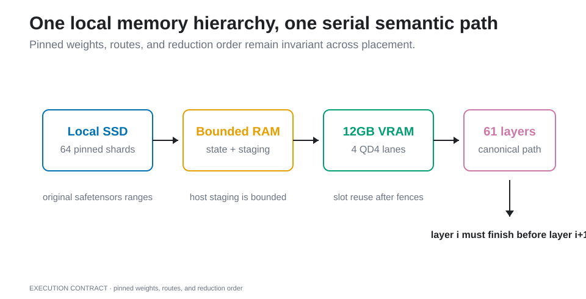
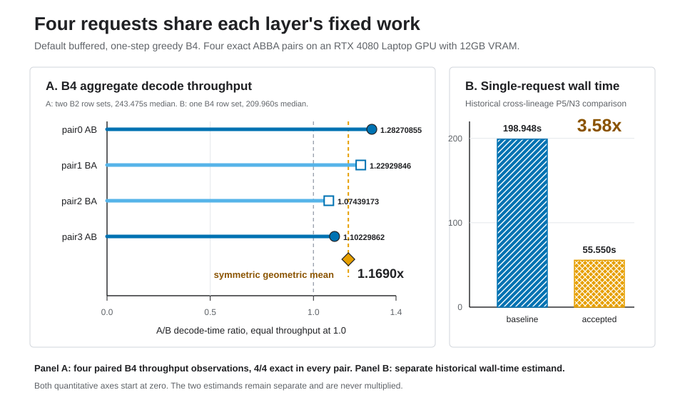
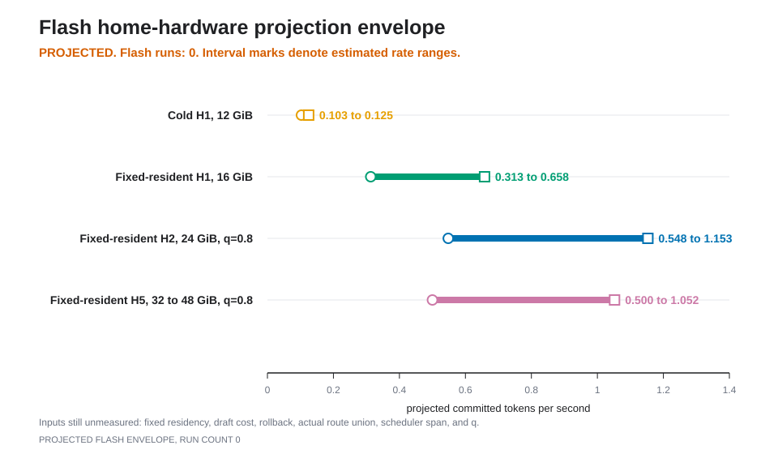

[English](README.md) | [简体中文](README.zh-CN.md)

# Want to Try Deploying a Full 1.6T MoE Model on Your Gaming Laptop?

Does Your Next LLM Infrastructure Really Need to Be an H100?

| **1.6T parameters** | **12GB VRAM** | **3.58x faster** |
| --- | --- | --- |
| Full 810GiB model directory | Exact bounded GPU working set | 198.948s to 55.550s |


localMoE is a Rust and CUDA runtime for one stubborn idea: a gaming laptop should be able to run the full DeepSeek-V4-Pro checkpoint in its full-weight form. The weights stay on a WSL-native ext4 volume. RAM and VRAM carry a moving working set. The runtime decides which bytes must move next and which work can stay shared.

On the measured RTX 4080 Laptop GPU with 12GB VRAM, the accepted P5/N3 request finished in `55.550s`; the recorded exact baseline took `198.948s`. That makes the visible result a `3.58x` descriptive cross-lineage speedup, with `72.1%` less wall time. The raw traces behind this historical local comparison remain in the local evidence archive and are absent from the repository. The commands below reproduce the workload against current source.

## A large MoE asks for a different runtime

V4-Pro has 61 serial layers. Each layer mixes fixed weights with router-selected experts. The GPU cannot keep the full 810GiB checkpoint resident, yet every layer still needs the right weights at the right instant. The hard part is therefore scheduling data movement without changing routes, reduction order, KV state, or the final committed state.

localMoE gives the checkpoint a travelling working set:

`ext4 SSD -> CPU read and decode -> pinned RAM -> retained VRAM -> canonical GPU reduction -> transactional state commit`



One layer is consumed while the next payload is prepared. Fixed payloads can remain in host or device retention. Routed experts use an immutable cache. CUDA streams and bounded Rust channels keep disk reads, CPU decode, H2D copies, and GPU execution in flight together. Ownership is explicit: move-only leases hold cache slots until GPU work is done, and RAII closes pinned-memory, event, and device-buffer lifetimes on every exit path.


## Share the work that the model already shares

> Four full61 requests shared each layer's fixed work and reached `1.1690x` aggregate decode throughput, a `16.9%` gain across four paired comparisons.



B4 keeps four request states independent while the row set pays the fixed work once per layer. Across all four pairs, 4/4 ordered layer digests, final semantics, and the physical ledger matched exactly under default buffered, one-step greedy execution.

## The path from gaming laptop to desktop build

The runtime is designed around bounded memory across GPU sizes. More VRAM can retain more fixed work; more host memory can keep more decoded payloads close to the GPU. That gives a clear upgrade path from a 12GB gaming laptop to a desktop with 16GB, 24GB, or 32GB to 48GB of VRAM.

| Home hardware | Flash projection | Assumption |
| --- | ---: | --- |
| 12GB gaming laptop | `0.103 to 0.125tok/s` | cold H1 |
| 16GB desktop | `0.313 to 0.658tok/s` | fixed-resident H1 |
| 24GB desktop | `0.548 to 1.153 committed tok/s` | fixed-resident H2, `q=0.8` |
| 32GB desktop | `0.500 to 1.052 committed tok/s` | fixed-resident H5, `q=0.8` |
| 48GB workstation | `0.500 to 1.052 committed tok/s` | same frozen 32GB to 48GB H5 envelope |

Compare each row within its scheduler assumption: H2 and H5 use different scheduler spans and continuous commit windows, so a cross-row ranking requires matching assumptions; more VRAM buys a longer usable window and more headroom.



These Flash ranges are design projections, with zero Flash benchmark runs so far. They show what the same scheduling model could unlock as more fixed work becomes resident. The 32GB and 48GB rows share the frozen H5 envelope. Fixed residency, draft cost, rollback, the actual route union, scheduler span, and acceptance rate still need measurement.

## What "exact" means here

localMoE preserves the Rust engine's declared canonical contract: route order, reductions, KV updates, lease release, and transactional state commits are checked within the tested lineage. The headline full-request comparison is descriptive because its endpoints come from different source lineages. Official PyTorch full-model parity, long-context behavior, prompt quality, sampling, and sustained throughput remain separate acceptance targets.

The experiment protocol, raw evidence boundaries, and limitations are in the [technical mechanism record](docs/experiments/v4-pro-mechanisms-2026-07-24.md). The README keeps the product story short; that record keeps the claims inspectable.

## Run the full checkpoint

The current path targets WSL2/Linux, CUDA 12.4, LLVM/NVPTX, libclang, and Ada `sm_89`. Store the pinned model revision on a WSL-native ext4 block device. The runtime rejects `/mnt/c` and `/mnt/d`.

```bash
git clone https://github.com/andyzpb/localMoE.git
cd localMoE/rust

export COLIBRI_DSV4_MODEL_DIR=/mnt/colibri-native/deepseek-v4-pro-b5968e9190ef611bbf34a7229255be88a0e937c1
export COLIBRI_CUBLAS_EXACT_LIB=/usr/local/cuda-12.4/targets/x86_64-linux/lib/libcublas.so.12.4.5.8
export LD_LIBRARY_PATH=/usr/local/cuda-12.4/targets/x86_64-linux/lib:${LD_LIBRARY_PATH:-}

cargo oxide doctor
./run-identified.sh build --arch sm_89 -- --release -p colibri-cuda
export COLIBRI_SOURCE_IDENTITY_MANIFEST="$PWD/.source-identity.manifest"
export COLIBRI_SOURCE_IDENTITY="$(sha256sum "$COLIBRI_SOURCE_IDENTITY_MANIFEST" | cut -d' ' -f1)"
export LOCALMOE_RUN_DIR="$(mktemp -d)"
```

Run the measured P5/N3 single-request path with a text prompt:

```bash
/usr/bin/time -f 'single_request_wall=%e s' env \
  COLIBRI_V4_FULL61_B1=1 \
  COLIBRI_V4_LAYER_STATIONARY_PREFILL=1 \
  COLIBRI_V4_GENERIC_DEVICE_STATIONARY=1 \
  COLIBRI_V4_CHAT_USER=hi \
  COLIBRI_V4_GREEDY_STEPS=3 \
  COLIBRI_V4_MAX_LAYERS=61 \
  COLIBRI_V4_DEVICE_FIXED_CACHE_GIB=0 \
  COLIBRI_V4_HOST_FIXED_CACHE_GIB=0 \
  COLIBRI_V4_STATIONARY_RAW_DEVICE_RETENTION_GIB=4.0 \
  COLIBRI_V4_STATIONARY_RAW_HOST_RETENTION_GIB=13 \
  COLIBRI_V4_LAYER_STATIONARY_FIXED_PREFETCH=1 \
  COLIBRI_V4_RAW_WO_A_GPU_DECODE=1 \
  COLIBRI_V4_PINNED_FIXED_PIPELINE=1 \
  COLIBRI_V4_BOUNDED_READAHEAD=1 \
  COLIBRI_V4_ROUTED_QD4=1 \
  COLIBRI_V4_QD4_IMMUTABLE_EXPERT_CACHE=1 \
  COLIBRI_V4_SPARSE_ATTN_ARM=sm89_crossover \
  COLIBRI_V4_RESULT_JSONL="$LOCALMOE_RUN_DIR/single.jsonl" \
  "$PWD/target/release/colibri-cuda"
```

Run the measured default-buffered B4 arm, which advances four independent full61 requests through one row set:

```bash
/usr/bin/time -f 'b4_cohort_wall=%e s' env \
  COLIBRI_V4_STREAM_READ_MODE=buffered \
  COLIBRI_V4_B4_GREEDY_ABBA_BENCH=1 \
  COLIBRI_V4_B4_GREEDY_ABBA_ARM=B \
  COLIBRI_V4_B4_TOKEN_IDS='0;1;2;3' \
  COLIBRI_V4_GREEDY_STEPS=1 \
  COLIBRI_V4_B4_GREEDY_ABBA_RESULT_JSONL="$LOCALMOE_RUN_DIR/b4.jsonl" \
  "$PWD/target/release/colibri-cuda"
```

The sealed reproduction record used fresh processes in the fixed `AB, BA, BA, AB` order, aggregate SHA-256 `7049525af8b0b5e246175920e51d6904749f7a4cd07d3fc590b3a77d4a57e4d0`, and binary SHA-256 `9a34c61754a7c66fc0124850e2fcc11056f25915c43bd4cff886ade784a04fbb`. Every arm stayed below the 14.726GiB RSS cap with zero sampled swap. Both runnable paths fail closed on strict canonical checks and commit their result only after all 61 layers complete.

Code is available under the [Apache License 2.0](LICENSE). Model weights follow their own release terms.

## Inspiration

localMoE was inspired by [JustVugg/colibri](https://github.com/JustVugg/colibri) and continues that line of work toward exact, full-weight MoE inference on home hardware.
