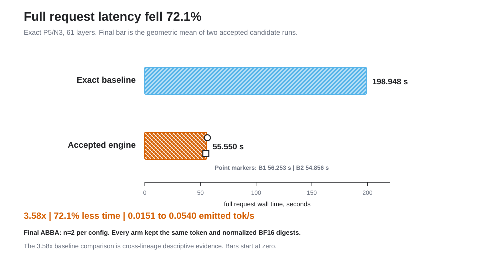

[English](README.md) | [简体中文](README.zh-CN.md)

# localMoE: Want to run the full 1.6T-parameter DeepSeek-V4-Pro on a gaming laptop?

localMoE is a Rust/CUDA runtime for running a full open-weight MoE checkpoint from local storage when the checkpoint is far larger than laptop memory. Its current pressure test is DeepSeek-V4-Pro: 61 layers, 64 official mixed FP4-FP8 shards, and `864.7 GB` of weights on a laptop with an RTX 4080 Laptop GPU, `12 GB` of VRAM, and `32 GB` of RAM.

| **1.6T parameters** | **12GB VRAM** | **2.23x faster** |
| --- | --- | --- |
| Full V4-Pro checkpoint stays local | Bounded GPU working set | Exact full-request development result |



The ambition is simple: a personal machine should be able to hold and execute a model that would usually be treated as datacenter-only. localMoE makes the storage and state schedule explicit, then keeps that schedule bounded enough for laptop hardware.

## The problem is placement under a semantic contract

A mixture-of-experts model activates only a fraction of its parameters for each token. The full checkpoint still has to be available. V4-Pro adds a harder shape: every generated token walks through 61 serial layers, each layer has recurring work, and each routed expert choice can change the bytes that must arrive next.

The question is larger than fitting files on an SSD. A runtime must move weights through a tiny working set while preserving route choices, reduction order, and the persistent attention state that the next token will read.


| Recorded laptop pressure test | Value |
| --- | ---: |
| GPU | NVIDIA GeForce RTX 4080 Laptop, `12,282MiB` VRAM |
| Host memory | `32GB` RAM |
| Checkpoint | `864,721,029,744B` across 64 pinned shards |
| Executed path | Complete 61-layer Rust canonical mechanism path |

The complete path keeps every pinned source shard local, visits every layer, and checks its own route, reduction, and state boundaries. It gives a hard system to optimize: storage and memory are scarce, while semantic shortcuts would make the result meaningless.

## A bounded streaming engine

localMoE treats a request as a sequence of leases and commits. The fixed trunk is the always-present work at each layer, including the recurrent tensor and state traffic. Routed experts are selected by that layer's router. Both travel through the same bounded pipeline:

`SSD -> RAM decode -> pinned host staging -> GPU lease -> canonical reduction -> transactional state commit`


The worker prepares the next payload while the GPU consumes the current one. A layer-stationary state layout keeps one persistent state per model layer and one request scratch space. Cache leases prevent a slot from being recycled while a worker still owns it. A transaction commits persistent state only after that layer has completed successfully.

This changes the optimization target. The engine can reduce storage reads, decode work, H2D traffic, and idle gaps without allowing a faster schedule to alter the model's observable state.

The routed cache shows the value of that framing. A strict full61 accounting audit cut routed source reads and routed H2D, field by field, from `64.223GB` to `29.620GB`: `53.9%` fewer bytes for the recorded workload.


## Performance

The headline compares the earliest retained exact full-request baseline with the current exact engine on the same P5/N3 request. Both use the same pinned V4-Pro weights, prompt IDs, greedy output, 61-layer schedule, and internal state-audit contract.

| Exact P5/N3 full request | Wall time | Emitted rate | Change |
| --- | ---: | ---: | ---: |
| Exact baseline | `198.95s` | `0.0151tok/s` | `1.00x` |
| Current exact engine | `89.28s` | `0.0336tok/s` | **`2.228x`** |

That is a `55.13%` reduction in complete-request latency. The result contains three emitted tokens. Sustained chat-service rate needs a separate measurement.

The current hot next-token trace is `14.789s/token`, or `0.0676tok/s`. The earliest retained exact trace on the same pinned weight family was `36.979s/token`, a separate `2.500x` development timing improvement with a different request shape.

The largest local mechanism result is `4.118x`: the QD4 routed-layer gate reduced recorded L4/P5 routed wall time from `486.605ms` to `118.170ms`, with all four paired checks exact. Its estimand is routed-layer wall time. The whole-request result uses its own measurement.

| What moved | Observed effect | Scope |
| --- | ---: | --- |
| Full exact request | `2.228x` faster | One P5/N3 request per condition |
| Hot next-token trace | `2.500x` faster | One P6 trace per condition |
| Routed QD4 gate | `4.118x` faster | Four paired local L4/P5 checks |
| Routed cache traffic | `53.9%` less | Full61 accounting audit |

## From a 1.6T pressure test to home inference

V4-Pro is deliberately unforgiving. It exposes the cost of streaming huge fixed payloads, sparse expert unions, state traffic, and the output head through a small memory hierarchy. A smaller MoE changes those terms, which is why the same engine should become much more useful on a desktop-class GPU.

DeepSeek-V4-Flash is the first planned target. It has zero runs in this repository today. The following rates are projected envelopes for a future port, computed from a model-specific work budget and labeled as projections throughout.


| Future V4-Flash plan | Projected committed rate |
| --- | ---: |
| Cold H1, 12GiB | `0.103 to 0.125tok/s` |
| Fixed-resident H1, 16GiB | `0.313 to 0.658tok/s` |
| Fixed-resident H2, 24GiB, `q=0.8` | `0.548 to 1.153tok/s` |
| Fixed-resident H5, 32 to 48GiB, `q=0.8` | `0.500 to 1.052tok/s` |

For another open-weight MoE, localMoE's planning model counts fixed-miss bytes, routed-expert union bytes, PCIe and GPU service, persistent-state work, and output-head cost. Those quantities form a portable roofline. The current runtime implements V4-Pro; each additional family needs its own metadata, routing semantics, KV layout, and acceptance gate.

## Why Rust

Rust contributes to the execution model. GEMM speed follows the kernel and hardware.

| Runtime constraint | Rust/CUDA mechanism |
| --- | --- |
| A cache slot has one live owner | Move-only leases make ownership explicit |
| Capacity must close before execution | Typed FP4-FP8 layouts produce byte budgets |
| I/O and GPU work must overlap | Bounded workers, pinned staging, streams, and events |
| Parallel work needs canonical semantics | Ordered reduction follows the canonical expert order |
| State may change only on success | Transactional commit gives each layer a clear boundary |
| Kernels need a native path | Colibri-owned CUDA kernels use `cuda-oxide` |

The result is a runtime whose placement decisions are inspectable. That matters when a single token depends on many asynchronous transfers and a small numerical difference can affect a later routing decision.

## Quickstart

The current path targets WSL2/Linux, CUDA12.x, LLVM/NVPTX, libclang, and an Ada `sm_89` GPU. Store model weights on a WSL-native ext4 block device. The environment contract rejects `/mnt/c` and `/mnt/d` for model storage.

```bash
git clone https://github.com/andyzpb/localMoE.git
cd localMoE/rust
cargo oxide doctor
cargo fmt --check
cargo check --locked -p colibri-cuda
./run-identified.sh test --arch sm_89
```

For a full61 oracle run, set `COLIBRI_DSV4_MODEL_DIR`, `COLIBRI_ORACLE_PYTHON`, and `COLIBRI_CUBLAS_EXACT_LIB` as described in the [full61 environment contract](rust/colibri-cuda/tools/V4_FULL61_ORACLE.md). The [mechanism experiment record](docs/experiments/v4-pro-mechanisms-2026-07-24.md) contains the model-run commands and fail-closed preflight.

<details>
<summary>Evidence boundary and projection assumptions</summary>

The full-request comparison has `n=1` per condition and is descriptive development evidence. It checks the recorded Rust canonical route, reduction, and transactional state boundary. Official PyTorch full61 parity has a separate acceptance gate.

The P6 `14.789s/token` record is a secondary timing lineage. Its current public artifact packet is pending, so the P5/N3 comparison is the primary public result.

Observed emitted rate uses `emitted tokens / request wall time`. The Flash planning expression uses a verification lower bound built from fixed misses, routed-expert union service, H2D/GPU work, serialized state work, and the head. For speculative horizon `H`, the illustrative committed-token factor is `E[C_H] = (1 - q^(H+1)) / (1 - q)`. The projected H2 and H5 rows use `q=0.8`; fixed residency, draft cost, rollback, actual expert union, and scheduler span await measurement.

The [Benchmark ledger](docs/assets/readme/cost-figures-provenance.json) retains figure inputs, formulas, artifact identities, and the underlying baseline/current lineage. The source identities differ across the two full-request development runs, which is why the `2.228x` comparison is labeled descriptive.
</details>

## License and inspiration

Code is available under the [Apache License 2.0](LICENSE). Model weights and associated materials follow their release terms. Retained upstream code and assets keep their existing notices and license terms.

localMoE is inspired by [JustVugg/colibri](https://github.com/JustVugg/colibri). It explores how far exact streamed MoE execution can go on hardware people already own.
