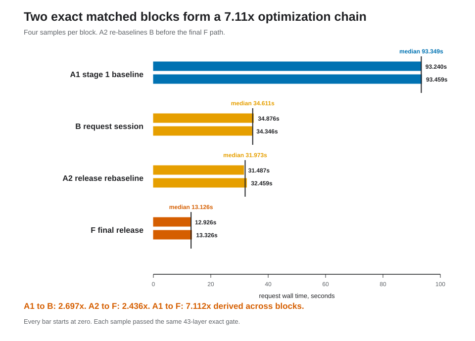

[English](README.md) | [简体中文](README.zh-CN.md)

# Want to Try Deploying a Full 1.6T MoE Model on Your Gaming Laptop?

Does Your Next LLM Infrastructure Really Need to Be an H100?

| Full checkpoint | Exact optimization chain | Final laptop result |
| --- | --- | --- |
| 1.6T Flash-0731 FP4 weights | 7.11x derived across two matched blocks | 0.0762tok/s on 12GB RTX 4080 Laptop GPU |



localMoE runs a full-weight DeepSeek-V4-Flash-0731 checkpoint on a gaming laptop by treating memory movement as inference work. The model stays on a WSL-native ext4 volume. Each layer brings fixed tensors and six routed experts into a bounded working set, then releases the lease after CUDA finishes with it.

The full chain begins at `93.349479730s` and ends at `13.126173804s` per one-token, 43-layer request. That is a `7.111705294x` derived end-to-end optimization chain, or about `0.0762tok/s` at the final median. The ratio joins two separately matched fresh-process blocks and carries the label derived chain value.

| Matched block | What changed | Exact timing result |
| --- | --- | --- |
| `A-B-B-A` | One checked cuBLAS session and workspace span the request's mHC and router calls | `93.349479730s` to `34.611048076s`, paired median `2.697283513x`, `4/4` exact |
| `A-F-F-A` | The same request-scoped session also reaches the compressor and indexer | `31.973254411s` to `13.126173804s`, paired median `2.435841263x`, `4/4` exact |

The compact [sample ledger](docs/assets/readme/flash-0731-abba.csv) contains all eight E2E values, maxRSS values, binary SHA-256 values, and exact gates. The final-release binary SHA-256 is `6a47f8fe48c87f4205f8f835a60f2f824940dea67c198463ccfb60ccf333bb77`. Its standalone full43 certificate run completed in `14.298313983s` with `1,412,424KiB` maxRSS; that certificate sits outside the matched timing blocks.


Median maxRSS fell from about `7.66GiB` in the first A block to `1.35GiB` in the final F block. Those samples sit in separate matched blocks, so the displayed `6.31GiB` reduction is derived in the same sense as the complete speedup chain.

## One request, one checked CUDA lifetime

Rust makes the lifetime of a request concrete. The request owns CUDA streams, events, pinned staging buffers, cache slots, the checked cuBLAS handle, and its workspace. A queued GPU operation keeps its lease alive. That allows a small set of stateful CUDA objects to stay warm across 43 layers while streamed weights remain bounded.

The first matched block keeps the verified cuBLAS handle and workspace across mHC and router linear calls. A final review repair carries the same lifetime through the compressor and indexer. In the final profile, attention time falls from `19.862862s` to `1.586645s`. This is one ownership rule expressed through the entire fixed-weight path.

The server follows the same rule. Its `gpu_exact` final head initializes from the live model at `READY` and remains part of the runtime. Captured-artifact directories stay outside the service startup path. The strict compressor and DSpark path reuse the checked session too.

## Exact Flash-0731 execution

The exact path fixes the numerical work that controls routes and state: FP8 MMA accumulation, ordered reductions, RMSNorm behavior, cuBLAS compressor calls, KV updates, and the GPU final head. For token ID `0` with one greedy step, all `43/43` layers matched the captured official reference at the declared comparison fields. The final argmax is `33832` and the checked digests are:

```
collapsed BF16   5e9764a6e105a3d6
normalized BF16  91495daa576afcb3
logits FP32      e9d90c64a1441d20
```

This certificate covers the pinned Flash-0731 revision, one prompt token, one greedy step, and the captured reference fields. Long contexts, sampling quality, sustained multi-user throughput, and other prompts each need their own evidence.

## DSpark commits a verified prefix

DSpark proposes a block, evaluates the base targets, then commits the accepted prefix. Its state transaction carries the base and three MTP state digests until commit. The recorded B regression run passed in `161.55s` with `1.124GiB` maxRSS. It completed eight base-equivalence counts across two prompt and six validated inputs, generated `[33832]`, accepted `0` proposals, committed one input, retained pending token `120159`, and recorded all four state digests.

The DSpark result ledger and the certified-base ledger have byte-identical SHA-256 `34734f…e553`. The retained artifact set contains the transaction record and four state digests. `exact-vs-certified-base` describes this evidence boundary. An independent official DSpark oracle remains future validation work.

## From gaming laptop to desktop platform

The final F median is `0.0762tok/s` on the current 12GB path. The planning ranges below retain the earlier memory-residency model's relative capacity multipliers and apply them to that measured median. They are sizing estimates with no benchmark-run evidence yet. Different scheduler windows guide configuration only.

| Hardware | Planning estimate | Model assumption |
| --- | ---: | --- |
| 12GB gaming laptop | `0.0750 to 0.0774tok/s` | observed final F samples |
| 16GB desktop | `0.209 to 0.440tok/s` | fixed-resident H1 multiplier |
| 24GB desktop | `0.366 to 0.771committed tok/s` | fixed-resident H2, `q=0.8` model |
| 32GB to 48GB workstation | `0.334 to 0.703committed tok/s` | fixed-resident H5, `q=0.8` model |

The estimates use `0.0761837tok/s`, multiplied by the earlier capacity-model band and divided by its 12GB midpoint of `0.114tok/s`. Fixed residency, route unions, draft cost, rollback, scheduler span, and acceptance rate still need measurements on each machine.

## Run it

The Flash path targets WSL2/Linux, CUDA 13.1, Blackwell `sm_120`, and a model directory on a WSL-native ext4 block device. The runtime rejects model paths under `/mnt/c` and `/mnt/d`.

```bash
git clone https://github.com/andyzpb/localMoE.git
cd localMoE/rust

export COLIBRI_DSV4_MODEL_DIR=/mnt/colibri-native/deepseek-v4-flash-0731-9e165c30e2704aec5d9d593cce3eebd58bbef1cb
export COLIBRI_CUBLAS_EXACT_LIB=/usr/local/cuda/targets/x86_64-linux/lib/libcublas.so.13.2.1.1
export LD_LIBRARY_PATH=/usr/local/cuda/targets/x86_64-linux/lib:${LD_LIBRARY_PATH:-}

cargo oxide doctor
./run-identified.sh build --arch sm_120 -- --release -p colibri-cuda
```

Run the real one-token Flash base path on `sm_120`:

```bash
env \
  COLIBRI_V4_FLASH_BASE=1 \
  COLIBRI_V4_FLASH_TOKEN_IDS=0 \
  COLIBRI_V4_GREEDY_STEPS=1 \
  COLIBRI_V4_STREAM_READ_MODE=buffered \
  COLIBRI_V4_FLASH_PREFETCH=1 \
  COLIBRI_V4_FLASH_MHC_LINEAR_ARM=cublas \
  COLIBRI_V4_FLASH_ROUTER_LINEAR_ARM=cublas \
  COLIBRI_V4_FLASH_ROUTER_SCORE_ARM=libdevice \
  COLIBRI_V4_FLASH_FP4_ACCUM_ARM=fp8_mma \
  COLIBRI_V4_FLASH_FINAL_HEAD_ARM=gpu_exact \
  COLIBRI_V4_RESULT_JSONL="$PWD/flash-result.jsonl" \
  "$PWD/target/release/colibri-cuda"
```

Inspect `flash-result.jsonl` for `layers: 43` and final `status: PASS`. The current 0731 ModelScope run is runtime-validated on `sm_120`; the historical `33832`/digest values above remain an independent oracle gate and must not be treated as passed until a matching full-43 oracle is regenerated. The checkpoint license governs model use. localMoE code is available under the [Apache License 2.0](LICENSE).

## Inspiration

localMoE was inspired by [JustVugg/colibri](https://github.com/JustVugg/colibri) and continues toward usable full-weight MoE inference on home hardware.
