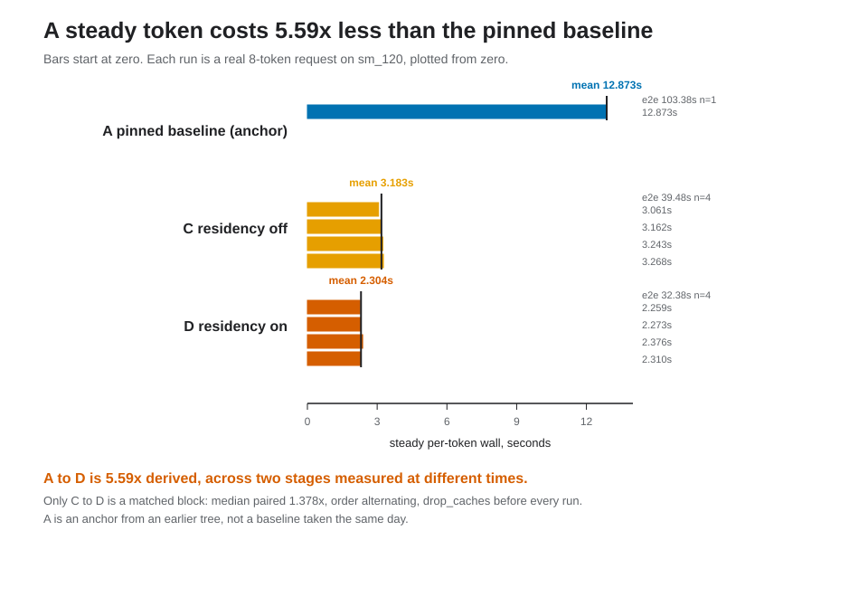
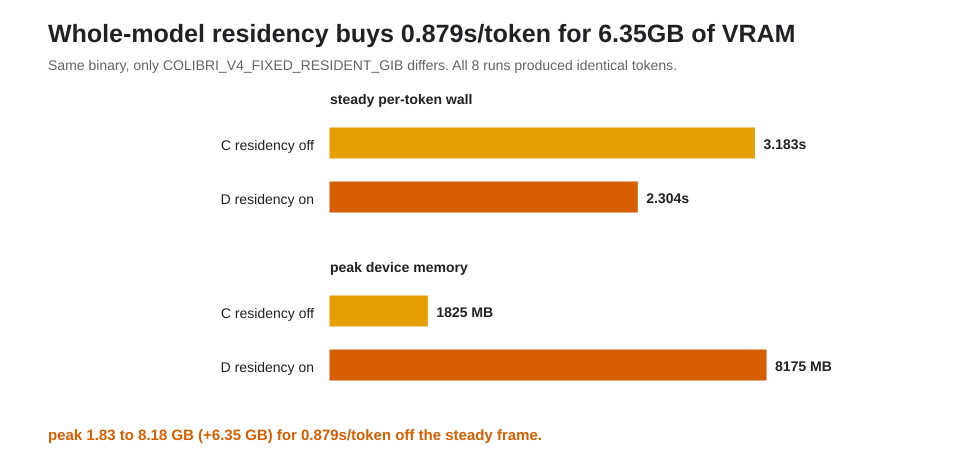

[English](README.md) | [简体中文](README.zh-CN.md)

# Want to Try Deploying a Full 1.6T MoE Model on Your Gaming Laptop?

Does Your Next LLM Infrastructure Really Need to Be an H100?

| Full checkpoint | Exact optimization chain | Result on this machine |
| --- | --- | --- |
| 1.6T Flash-0731 FP4 weights | 6.50x derived on the steady frame | 0.505tok/s on 16GB RTX 5060 Ti |



localMoE runs the full-weight DeepSeek-V4-Flash-0731 checkpoint on a single consumer card by treating memory movement as inference work. The model stays on a WSL-native ext4 volume. Each layer brings fixed tensors and six routed experts into a bounded working set, then releases the lease after CUDA finishes with it.

Everything below was measured on one machine: an RTX 5060 Ti with 16GB, compute capability `sm_120`, under WSL2 with CUDA 12.8. A steady token fell from `12.873s` at the pinned baseline to `2.304s` under whole-model residency, and to `1.98s` once the routed fan-out became the default. That is a `6.50x` reduction, derived across three stages measured at different times rather than from one matched block. At the current default it is about `0.505tok/s`.

| Stage | What changed | Exact timing result | How it was measured |
| --- | --- | --- | --- |
| `C-D-D-C` | Whole-model fixed weights stay resident in VRAM | `3.183s` to `2.304s` per steady token, paired median `1.378x`, `4/4` identical output | One matched 4-round interleaved batch, same binary, one flag |
| `E` | Routed experts fan out over six streams instead of queueing on one | `2.39s` to `1.98s` per steady token, `−17%`, identical output | Two matched batches (default-first and off-first), 3 rounds per arm, same binary, one flag; `+64MiB` peak, and the serve surface repeats the same eight ids at `−0.464s/char` |
| `A` | Pinned non-resident baseline | `12.873s` per steady token, e2e `103.381s` | Anchor from an earlier tree, not a baseline taken the same day |

Two pairs are real matched blocks — the residency pair and the fan-out pair — so their ratios are measurements. The `6.50x` headline joins them to a baseline measured on an earlier tree; each stage is solid on its own, but the end-to-end ratio is derived, not observed in a single run. The figure below plots the residency chain, so its last bar is the residency default rather than today's.

The compact [run ledger](docs/assets/readme/sm120-steady-ab.csv) lists every run value, its peak device bytes, and the source result file behind it. The residency batch ran on `codex/business-restart` at `8e162a6`; result files carry no binary fingerprint, so those numbers are re-derived from the files under `/srv/localmoe/targets/residentfill/`, not from a checksum in the repository.



Keeping the whole fixed-weight set resident costs `+6.35GB` of device memory — peak rises from `1,825MB` to `8,175MB` — and buys `0.879s` off every steady token. All eight runs in the matched batch produced byte-identical tokens, so this is a pure speed change. On a 16GB card it leaves roughly 8GB free; that budget is the constraint to check before making anything else resident.

## One request, one checked CUDA lifetime

Rust makes the lifetime of a request concrete. The request owns CUDA streams, events, pinned staging buffers, cache slots, the checked cuBLAS handle, and its workspace. A queued GPU operation keeps its lease alive. That allows a small set of stateful CUDA objects to stay warm across 43 layers while streamed weights remain bounded.

The same rule now covers the weights themselves. The fixed tensors for all 43 layers are captured in `B2RawRuntime` after their first read and served from VRAM for every later token; `fixed_source_bytes` and `fixed_h2d_bytes` are reported as zero on a hit, so the ledger shows the saving directly. Prefetch stays on during the fill pass and is skipped only once the next layer is already resident, so the first token is not slower than the streaming path.

The server follows the same rule. It runs the same `run_v4_b2_generate_arm` loop as the CLI, and the residency gate covers both the `FLASH_BASE` and `FLASH_SERVE` surfaces.

## Pinned Flash-0731 execution on sm_120

The exact path pins the numerical work that controls routes and state: FP8 MMA accumulation, ordered reductions, RMSNorm behavior, cuBLAS compressor calls, KV updates, and the final head. On this machine, for token ID `0` with one greedy step, the run reproduces a fixed set of values across every change described here:

```
argmax                 55222
hidden_bf16_digest     5ed8bf88beae3cfe
layers                 43
fp4_accum              block32
final_head             canonical_cpu_streamed_bf16
```

An 8-step request reproduces this digest chain, which the project's own check script compares token by token:

```
5ed8bf88beae3cfe, 316e5495ca424b39, a521547b2586e458, 1963dfeaaf30264c,
b970da7913a57a1c, 12c6b45cecf9d53b, e0f441542fa53991, 69ed859929ee9042
```

Every optimization in the table above was accepted only after these eight digests, eight 43-layer summary chains, and eight argmax values matched the previous stage bit for bit.

One honest limit: on `sm_120` the official TileLang FP4 kernel does not reproduce. The same weights and inputs give different outputs between runs — a `M=1, N=2048, K=4096` reproducer reports `2048/2048` elements wrong and a run-to-run spread of `6.912e+01`. The guess is that TileLang 0.1.8 emits `sm_100` code and consumer `sm_120` lacks the tensor-core instruction it targets; that guess is not verified. So the pinned values above are this engine's own reproducible regression gate, not a certificate that we match the official reference on `sm_120`. Pinning the official oracle to a stable TileLang version reached agreement on token `55222`, but the two implementations still first diverge at layer 8 in `route_weight_bits`, and neither side has been judged correct. The `43/43` reference-match certificate in the [archived sm_89 README](docs/archive/README.sm89-12gb-rtx4080.md) was measured on a different card and must not be read as passed here.

## The DSpark arm was removed (2026-10-01)

An earlier revision shipped a speculative-decoding arm: DSpark proposed a block, evaluated the base targets, then committed the accepted prefix, carrying the base and three MTP state digests in its state transaction. It is gone, because measurement says it cannot pay for itself.

On `sm_120` the draft accepted `0` of `30` proposals, and `0` of `20` again after the first defect was fixed — while reproducing the base greedy output exactly and running about `16x` slower than decoding directly. Debugging did find one real bug on the way: the `rope_v4_bf16` kernel silently returned for anything wider than four rows, so a five-row draft got zeroed `q` and `query_kv`. The host now refuses that launch with an explicit error instead of returning a zeroed tensor. A second defect was never resolved: the draft `confidence` lands at `10^3..10^4` where the contract wants `O(1)`.

It was dropped rather than fixed because of arithmetic. One round spends one anchor plus five row-by-row base forwards to commit at most six tokens, so accepting all five drafts only breaks even, and the three draft stages make it a net loss. The work that would change that — verifying N rows in one pass — benefits the base path on its own, so there was nothing left for an arm to add. `COLIBRI_V4_FLASH_DSPARK` is now a hard error instead of a silent fall-through. The investigation, its excluded suspects and the unresolved `confidence` entry point stay in [`docs/experiments/2026-09-18-sm120-dspark-acceptance.md`](docs/experiments/2026-09-18-sm120-dspark-acceptance.md).

## What a token costs now

Steady state, current defaults, measured from the phase profile of the residency batch. What each item is, and where it came from:

| # | Item | Per token | What is inside |
| --- | --- | --- | --- |
| 1 | Expert path: the `routed` row, six lanes overlapped | `0.58s` | Each lane reads, uploads and runs its own expert on its own stream, and the layer ends on the slowest lane. The reads still sit at the disk ceiling; the old restage copy is gone. The per-lane `setup`/`h2d`/`kernel` figures are sums over overlapping lanes and must not be added |
| 2 | `attention` | `0.58s` | Compressor `0.20s` and indexer `0.08s` are still host-side; the 16 small steps moved to the device |
| 3 | `shared` | `0.46s` | Now the MLP alone. The six lanes push it up by about `9.9ms` per layer through their uploads (about `4.5ms`, sharing PCIe) and kernels (about `5.4ms`, sharing SMs), but the slowest lane is still longer, so it does not bind |
| 4 | `router` | `0.13s` | |
| 5 | `final head` (outside the layer loop) | `0.10s` | 1.01GiB of weights per token, across 6 threads instead of 1 |
| 6 | `fixed` | `0` | Resident by default; returns to about `0.81s` with `COLIBRI_V4_FIXED_RESIDENT_GIB=0` |

The steady wall is `1.98s`. Each row is a per-token phase mean over tokens 1–7 with the first layer of every token excluded, so the rows sum slightly below the wall.

This is a profile of moving bytes, not of arithmetic: the 18 GEMMs inside attention account for `0.2–0.3%`. The only two directions are to move less or to overlap it with something else. The floor is the larger of the two sides, not their sum: the 3.45GB of expert bytes that must come off the disk each token are worth `0.94s` at the measured `3.66GB/s`, while the non-read side (shared MLP, attention, router, expert kernels) is about `1.4s` — so roughly `1.3–1.4s` per token, and the fan-out default has already been measured at `1.549s` on a real prompt, with an ablation that skips the lane kernels landing at `1.352s`.

Two things about this table are worth stating so it does not mislead. The `shared` row used to wrap two activities at once — the MLP on the main thread and six workers reading routed experts — and about three quarters of it belonged to the expert path; since the fan-out became the default those reads live inside the lanes, so the row is the MLP alone after its cost of sharing PCIe and SMs. And `final head` was once recorded as `~0.13s` by reading only its disk portion; the full wall is the `outer.wall_ns` number, and it is a real fourth item.

## From a single 16GB card

The card is now the budget. `fixed` is zero because 6.71GB of weights live in VRAM; peak is `8.24GB`, leaving about 8GB. The values below are the measured steady frame and its remaining headroom, not projections.

| Configuration | Steady per token | Peak device memory | Left free on a 16GB card |
| --- | ---: | ---: | ---: |
| Current default (residency + fan-out) | `1.98s` | `8,242MB` | `~8GB` |
| Fan-out off (`COLIBRI_V4_FLASH_ROUTED_FANOUT=0`) | `2.39s` | `8,175MB` | `~8GB` |
| Residency off (`COLIBRI_V4_FIXED_RESIDENT_GIB=0`) | `3.183s` | `1,825MB` | `~14GB` |

The two fan-out rows are from one 2026-09-30 batch (single-token prompt, both orderings); the residency row is from the residency batch, so the three absolute values are not from one block.

Two known ceilings bound what is left. The input cap is 128 total tokens (`prompt + generated − 1`), so a prompt longer than 121 tokens is rejected with `CONTEXT_WINDOW_EXCEEDED`, and time to first token still grows by roughly `2.6s` per prompt token. And the service surface writes a per-phase split only when you opt in (`COLIBRI_V4_FLASH_SERVE_PHASE_JSONL`), so its per-phase split is measured for one prompt rather than in general — though the two surfaces have been checked at the same speed on steady state.

## Run it

The Flash path targets WSL2/Linux, CUDA 12.8, Blackwell `sm_120`, and a model directory on a WSL-native ext4 block device. The runtime rejects model paths under `/mnt/c` and `/mnt/d`.

```bash
git clone https://github.com/andyzpb/localMoE.git
cd localMoE/rust

export COLIBRI_DSV4_MODEL_DIR=/mnt/colibri-native/deepseek-v4-flash-0731-9e165c30e2704aec5d9d593cce3eebd58bbef1cb
export COLIBRI_CUBLAS_EXACT_LIB=/usr/local/cuda-12.8/targets/x86_64-linux/lib/libcublas.so.12.8.5.5
export LD_LIBRARY_PATH=/usr/local/cuda-12.8/targets/x86_64-linux/lib:${LD_LIBRARY_PATH:-}

cargo oxide doctor
./run-identified.sh build --arch sm_120 -- --release -p colibri-cuda
```

Run the real Flash base path on `sm_120`. Leave `FP4_ACCUM_ARM` and `FINAL_HEAD_ARM` unset: that confirms the default arms are still `block32` and `canonical_cpu_streamed_bf16`.

```bash
env \
  COLIBRI_V4_FLASH_BASE=1 \
  COLIBRI_V4_FLASH_TOKEN_IDS=0 \
  COLIBRI_V4_GREEDY_STEPS=8 \
  COLIBRI_V4_STREAM_READ_MODE=buffered \
  COLIBRI_V4_FLASH_PREFETCH=1 \
  COLIBRI_V4_FLASH_MHC_LINEAR_ARM=cublas \
  COLIBRI_V4_FLASH_ROUTER_LINEAR_ARM=cublas \
  COLIBRI_V4_FLASH_ROUTER_SCORE_ARM=libdevice \
  COLIBRI_V4_RESULT_JSONL="$PWD/flash-result.jsonl" \
  "$PWD/target/release/colibri-cuda"
```

Inspect `flash-result.jsonl` for `layers: 43`, `hidden_bf16_digest: 5ed8bf88beae3cfe`, and `generated_ids` starting `55222, 33832, ...`. The `status: PASS` field means the 43-layer run completed, not that any oracle gate passed. Whole-model VRAM residency is on by default; set `COLIBRI_V4_FIXED_RESIDENT_GIB=0` to fall back to streaming and to recover the `1,825MB` peak. Result files from the runs behind these numbers live outside the repository under `/srv/localmoe/targets/`, so the timing figures cannot be re-derived from tracked files alone. The checkpoint license governs model use. localMoE code is available under the [Apache License 2.0](LICENSE).

## Inspiration

localMoE was inspired by [JustVugg/colibri](https://github.com/JustVugg/colibri) and continues toward usable full-weight MoE inference on home hardware. The `sm_89` measurements on a 12GB RTX 4080 Laptop are kept in [docs/archive](docs/archive/README.sm89-12gb-rtx4080.md).
