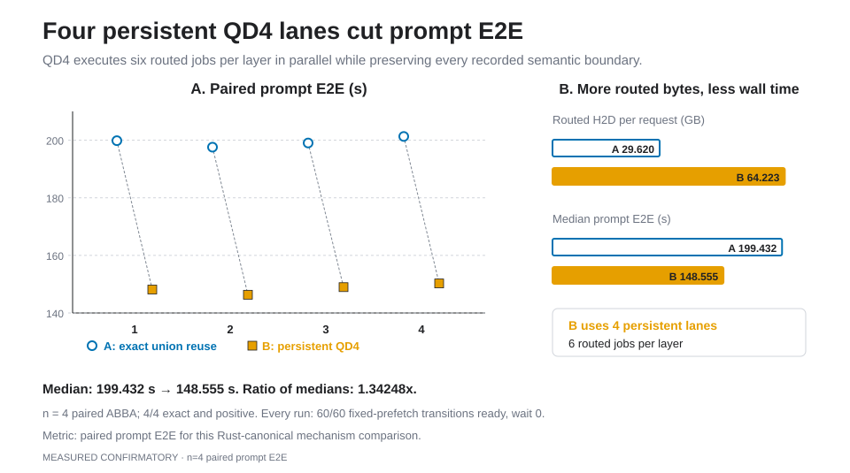
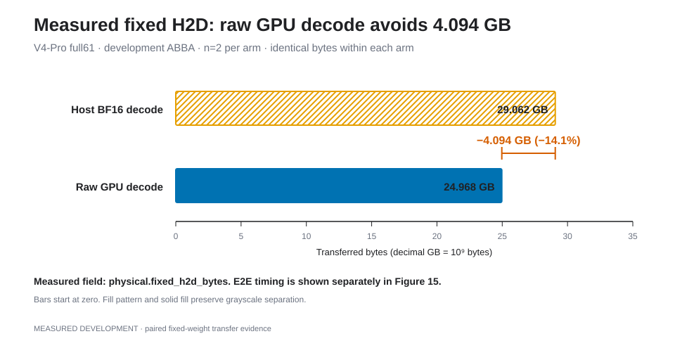
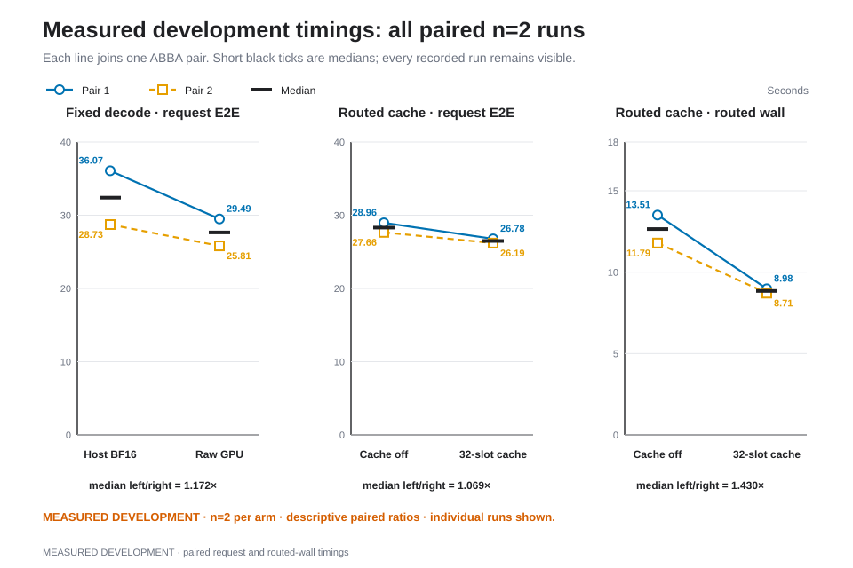

[English](README.md) | [简体中文](README.zh-CN.md)

# localMoE: Want to run a full 1.6T-parameter MoE on your gaming laptop?

localMoE schedules the complete `864.7 GB`, 61-layer DeepSeek-V4-Pro checkpoint from local SSD on a laptop with an RTX 4080 Laptop GPU, 12 GB of VRAM, and 32 GB of RAM. The model is a 1.6T-parameter MoE stored as 64 official mixed FP4-FP8 shards. Rust keeps the moving window bounded; the checkpoint stays local.

## 2.23x faster full request, with the same model and exact state checks

The main result compares two complete P5/N3 requests. They use the same pinned model revision, prompt IDs, greedy output, 61-layer schedule, and state-audit contract. V8 recorded QD4 off; V9 recorded QD4 on. Their run-identified source identities differ, so the ratio is a descriptive development comparison.


| Full-request condition | Request wall time | Emitted rate | State result |
| --- | ---: | ---: | --- |
| V8, QD4 off | `198.947779573 s` | `0.015079334 tok/s` | PASS |
| V9, QD4 on | `89.277349596 s` | `0.033603148 tok/s` | PASS |

The descriptive ratio is `2.228423900x`, with `55.125234%` lower request latency. Both runs emitted `[115287, 115287, 115287]`, traversed all 61 layers, made 427 transactional commits, and passed 183 audited layer-state comparisons at P4, P5, and P6. Their JSONL SHA-256 identities are `781ccffe…` and `52d7c04b…`. With `n=1` per condition, this evidence records two development runs. The [Benchmark ledger](docs/assets/readme/cost-figures-provenance.json) records full artifact hashes, full run-identified source identities, inputs, formulas, and scope.

The exactness claim here covers the recorded Rust canonical route, reduction, and state boundary. Official PyTorch full61 parity has its own acceptance gate.

## The pressure test

The checkpoint is larger than either fast-memory tier. The runtime has to stream weights without changing canonical reduction order or committing partial persistent state.


| Recorded system | Value |
| --- | --- |
| GPU | NVIDIA GeForce RTX 4080 Laptop, `12,282 MiB` VRAM |
| Host memory | `32 GB` RAM |
| Checkpoint | 64 pinned shards, `864,721,029,744 B` actual files |
| Executed path | Complete 61-layer Rust canonical mechanism path |

Complete means every pinned shard is local and the recorded path traverses all 61 layers. General chat, sampling, long context, thermally sustained throughput, service behavior, and official-reference parity still need separate evaluation.

## The mechanism evidence

The full-request comparison keeps the canonical route and state commitments checked while recording the QD4 configuration in each run.

The local L4/P5 gate cut routed wall time from `486.604659 ms` to `118.169615 ms`, a `4.117849x` speedup. All `4/4` pairs were exact. Its estimand is routed-layer wall time; full-request throughput uses the separate complete-request runs above.

The independent full61 ABBA packet reduced prompt E2E from `199.431954 s` to `148.555131 s`, a `1.342477723x` ratio of medians. It has `4/4` exact pairs and 305 layer records plus the final output in each pair.



The other retained experiments show why the streaming path has room to move:

| Mechanism and estimand | Observed result | Evidence boundary |
| --- | --- | --- |
| Raw GPU fixed decode, full61 H2D | `29.062 GB` to `24.968 GB`, `14.1%` less | paired development, `n=2` per arm |
| Immutable 32-slot routed cache, bytes per field | `64.223 GB` to `29.620 GB`, `53.9%` less | paired development, strict accounting audit |
| Raw GPU fixed decode, request E2E median | `1.171788x` | paired development, `n=2` per arm |
| Routed cache, routed-wall median | `1.430045x` | paired development, `n=2` per arm |
| Routed cache, request E2E median | `1.068977x` | paired development, `n=2` per arm |






Each ratio answers its own estimand. The local `4.117849x` gate, the `1.342477723x` prompt packet, and the `2.228423900x` P5/N3 request comparison remain separate measurements.

## Why the Rust path matters


The current runtime uses move-only leases for cache ownership, typed FP4-FP8 geometry for capacity checks, bounded workers with pinned staging, canonical routed reduction, and transactional state commit. Colibri-owned CUDA kernels use `cuda-oxide`. Those constraints make it possible to overlap storage, CPU decode, H2D, and GPU execution while retaining a concrete state boundary to audit.

## A second development lineage

The original P6 next-token trace fell from `36.979170611 s/token` to `14.789027100 s/token`, a descriptive `2.500446470x` change or `60.007142%` lower latency. The reciprocal rate rose from `0.0270422506 tok/s` to `0.0676177002 tok/s`.


The chart records a narrower P6 pre-pipeline comparison of `1.1605x`. The old `36.979170611 s/token` artifact is identified in the ledger and retained diagrams. Copying the current `14.789027100 s/token` record into the tracked artifact packet is pending, so this lineage remains secondary development evidence. It uses the same pinned model family and exact runtime boundary with a request shape distinct from the P5/N3 main comparison.

## Flash projection envelope

DeepSeek-V4-Flash runs in this repository: `0`. The rates below are recalculated projection envelopes for a future Flash port. Benchmark evidence begins with the Flash implementation and its measured runs.


| Hardware and plan | Projected committed rate | Assumptions |
| --- | ---: | --- |
| Cold H1, 12 GiB | `0.103 to 0.125 tok/s` | Flash run count `0` |
| Fixed-resident H1, 16 GiB | `0.313 to 0.658 tok/s` | fixed residency unimplemented |
| Fixed-resident H2, 24 GiB, `q=0.8` | `0.548 to 1.153 tok/s` | draft and rollback costs unmeasured |
| Fixed-resident H5, 32 to 48 GiB, `q=0.8` | `0.500 to 1.052 tok/s` | route union and scheduler span unmeasured |

The H2 and H5 ranges are sensitive to the conditional acceptance assumption `q`:

| `q` | H2 committed rate | H5 committed rate |
| ---: | ---: | ---: |
| `0.7` | `0.492 to 1.035 tok/s` | `0.399 to 0.839 tok/s` |
| `0.8` | `0.548 to 1.153 tok/s` | `0.500 to 1.052 tok/s` |
| `0.9` | `0.609 to 1.281 tok/s` | `0.635 to 1.336 tok/s` |

Flash fixed residency, draft cost, rollback, actual route union, scheduler span, and `q` await measurement. A smaller open-weight MoE should be evaluated with a parameterized roofline based on its active fixed-miss bytes, routed-expert union, PCIe/GPU service, and output-head cost. Those active data-movement and compute terms determine speed.

## Reproduce the current path

Use WSL2/Linux, CUDA 12.x, LLVM/NVPTX, libclang, and an Ada `sm_89` GPU. Store the checkpoint on WSL-native ext4. The environment contract rejects `/mnt/c` and `/mnt/d` for model storage. Set `COLIBRI_DSV4_MODEL_DIR`, `COLIBRI_ORACLE_PYTHON`, and `COLIBRI_CUBLAS_EXACT_LIB` as described in the [full61 environment contract](rust/colibri-cuda/tools/V4_FULL61_ORACLE.md).

```bash
git clone https://github.com/andyzpb/localMoE.git
cd localMoE/rust
cargo oxide doctor
cargo fmt --check
cargo check --locked -p colibri-cuda
./run-identified.sh test --arch sm_89
```

The [mechanism experiment record](docs/experiments/v4-pro-mechanisms-2026-07-24.md) contains the model-run commands and fail-closed preflight. The [Benchmark ledger](docs/assets/readme/cost-figures-provenance.json) records compact public identities and figure inputs.

## Repository layout

```text
rust/colibri-cuda/          Rust + cuda-oxide V4-Pro prototype
rust/colibri-cuda/tools/    oracle, trace, and evidence tools
docs/assets/readme/         deterministic figures and compact evidence artifacts
c/                          retained upstream C/CUDA oracle and baseline
```

## License

Code remains under [Apache License 2.0](LICENSE). Model weights and associated materials follow the terms on the model release page. Retained upstream code and assets keep their existing notices and license terms.

## Inspiration

localMoE is inspired by [JustVugg/colibri](https://github.com/JustVugg/colibri) and aims to take local MoE execution further.
