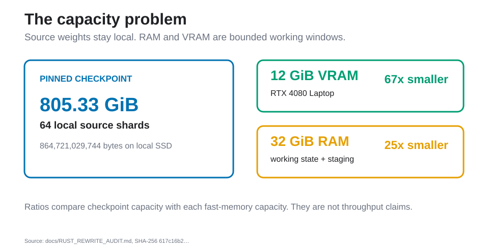

[English](README.md) | [简体中文](README.zh-CN.md)

# Want to Try Deploying a Full 1.6T MoE Model on Your Gaming Laptop?

Does Your Next LLM Infrastructure Really Need to Be an H100?

| **1.6T parameters** | **12GB VRAM** | **2.228x faster** |
| --- | --- | --- |
| Full V4-Pro checkpoint stays local | Bounded GPU working set | Exact full-request development result |


The goal is personal inference for models that normally imply datacenter hardware. A local SSD can hold the full checkpoint. Each token depends on routed expert weights moving through a small working set in the required order. localMoE preserves the model's arithmetic and optimizes that data flow.

## The idea: preserve model arithmetic and optimize data flow

An MoE activates a sparse subset of its parameters for each token. The complete expert set remains addressable throughout the request. V4-Pro makes this demanding: every generated token crosses 61 serial layers, each layer has fixed work, and its router determines which expert bytes must arrive next.

localMoE treats that as a placement problem under a semantic contract. A request follows one bounded path:

`SSD -> RAM decode -> pinned host staging -> GPU lease -> canonical reduction -> transactional state commit`


The runtime overlaps preparation of the next payload with GPU work on the current payload. Layer-stationary state keeps persistent state per model layer and one scratch space per request. Cache leases protect a slot while a worker owns it, and a layer commits persistent state only after successful completion. The engine reduces I/O, decode, H2D traffic, and idle time. Route choice, reduction order, and observable state follow the canonical contract.



| Recorded V4-Pro pressure test | Value |
| --- | ---: |
| GPU | NVIDIA GeForce RTX 4080 Laptop, `12,282MiB` VRAM |
| Host memory | `32GB` RAM |
| Checkpoint | `864,721,029,744B` across 64 pinned shards |
| Executed path | Complete 61-layer Rust canonical mechanism path |

## Current evidence

The README generator freezes two manually recorded `n=1` full-request timings for the same P5/N3 configuration. Their quotient is the displayed `2.228x` development comparison. The recorded metadata lists the same pinned V4-Pro weights, prompt IDs, greedy output, 61-layer schedule, and internal state-audit contract.

| Exact P5/N3 full request | Wall time | Emitted rate | Change |
| --- | ---: | ---: | ---: |
| Exact baseline | `198.95s` | `0.0151tok/s` | `1.00x` |
| Current exact engine | `89.28s` | `0.0336tok/s` | **`2.228x`** |

The frozen timing inputs give a `55.13%` reduction in complete-request latency. Each request emits three tokens. A separate full61 accounting audit reduced routed source reads and routed H2D from `64.223GB` to `29.620GB`, a `53.9%` reduction for its recorded workload.

The public artifact for this comparison is the frozen [README generator](docs/assets/readme/generate_cost_figures.py) and [benchmark ledger](docs/assets/readme/cost-figures-provenance.json) record. The two timing entries have different source identities, so the result remains descriptive development evidence. It validates the recorded Rust canonical route, reduction, and transactional state boundary. Sustained chat-service throughput requires a separate benchmark, and official PyTorch full61 parity has a separate acceptance gate.

## A route to home inference

V4-Pro is an intentionally severe storage-and-state pressure test. It exposes the cost of fixed payloads, sparse expert unions, persistent state traffic, and the output head across a small memory hierarchy. The same scheduling model can be evaluated on smaller MoEs where those terms are more favorable for home hardware.

DeepSeek-V4-Flash is the first planned target. The following Flash intervals are illustrative projection inputs frozen in the README generator and benchmark ledger. This repository has zero Flash runs, and measured performance is still pending.


| Future V4-Flash configuration | Projected committed rate |
| --- | ---: |
| Cold H1, 12GiB | `0.103 to 0.125tok/s` |
| Fixed-resident H1, 16GiB | `0.313 to 0.658tok/s` |
| Fixed-resident H2, 24GiB, `q=0.8` | `0.548 to 1.153tok/s` |
| Fixed-resident H5, 32 to 48GiB, `q=0.8` | `0.500 to 1.052tok/s` |

These intervals are illustrative planning inputs. Future measurement must establish fixed residency, draft cost, rollback, actual expert unions, scheduler span, and the acceptance probability `q`. Each model family also needs its own metadata, routing semantics, KV layout, and acceptance gate.

## Why Rust

Rust makes the runtime's constraints visible in the code. Move-only leases express cache ownership, typed FP4-FP8 layouts produce byte budgets, bounded workers and CUDA streams overlap I/O with GPU work, ordered reductions preserve canonical expert order, and transactional commits protect persistent state. GEMM speed still follows the kernel and hardware.

## Quickstart

The current path targets WSL2/Linux, CUDA12.x, LLVM/NVPTX, libclang, and an Ada `sm_89` GPU. Store model weights on a WSL-native ext4 block device. The environment contract rejects `/mnt/c` and `/mnt/d` for model storage.

```bash
git clone https://github.com/andyzpb/localMoE.git
cd localMoE/rust
cargo oxide doctor
cargo fmt --check
cargo check --locked -p colibri-cuda
./run-identified.sh test --arch sm_89
```

## License and inspiration

Code is available under the [Apache License 2.0](LICENSE). Model weights and associated materials follow their release terms. Retained upstream code and assets keep their existing notices and license terms.

localMoE is inspired by [JustVugg/colibri](https://github.com/JustVugg/colibri). It explores how far exact streamed MoE execution can go on hardware people already own.
