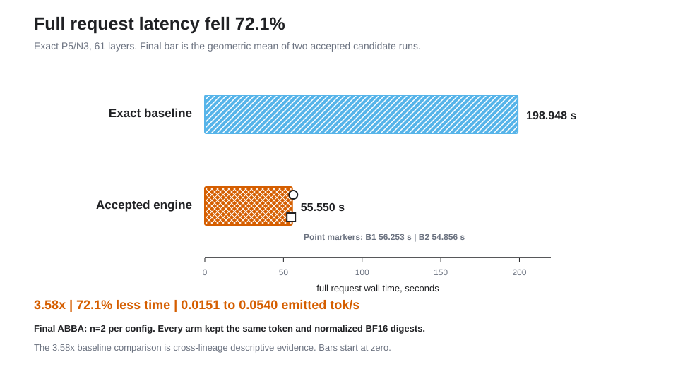
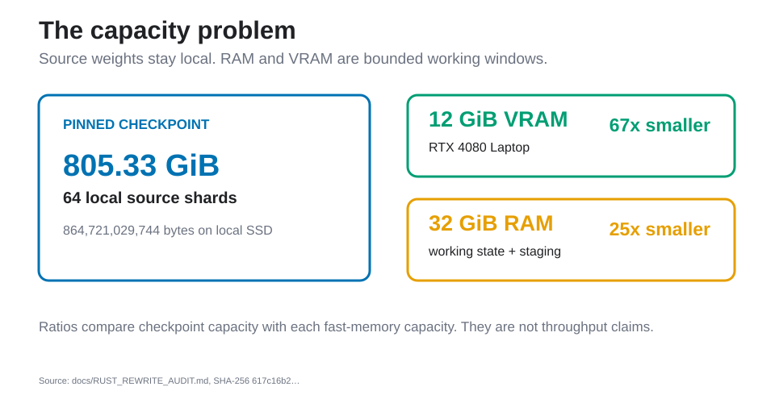
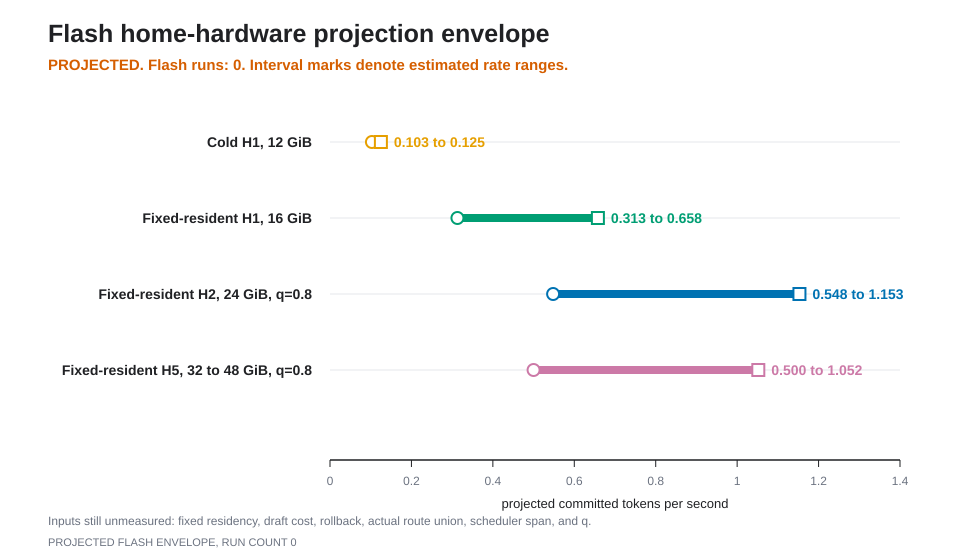

[English](README.md) | [简体中文](README.zh-CN.md)

# localMoE：想不想在你的游戏本上亲自部署全量1.6T参数DeepSeek-V4-Pro？

localMoE是一个Rust/CUDA运行时，面向“完整开源MoE检查点远大于笔记本内存”的本地推理问题。当前压力测试是DeepSeek-V4-Pro：61层、64个官方混合FP4-FP8分片、`864.7GB`权重，运行平台为RTX4080Laptop GPU、`12GB`显存和`32GB` RAM。

| **1.6T参数** | **12GB显存** | **快2.23倍** |
| --- | --- | --- |
| 完整V4-Pro检查点留在本地 | GPU工作集保持有界 | exact完整请求开发结果 |



我们想做的事情很直接：个人电脑也应当能够保存并执行通常只会被当作数据中心任务的大模型。localMoE把存储与状态调度写成明确的运行时约束，再把它压进笔记本可承受的有界工作集。

## 这是一个带语义约束的放置问题

MoE每个token只激活部分参数，完整检查点依然要随时可用。V4-Pro的形状更苛刻：每个生成token都要串行经过61层，每层都有重复出现的工作，路由专家又会改变下一步需要搬运的字节。

难点超过了把文件放进SSD。运行时需要在极小工作集里移动权重，同时保持路由选择、归约顺序，以及下一个token要读取的持久注意力状态。



| 记录的笔记本压力测试 | 数值 |
| --- | ---: |
| GPU | NVIDIA GeForce RTX4080Laptop，`12,282MiB`显存 |
| 主机内存 | `32GB` RAM |
| 检查点 | 64个固定分片，共`864,721,029,744B` |
| 已执行路径 | 完整61层Rust规范机制路径 |

完整路径让每个固定源分片保持在本地，走完全部层，并检查自身的路由、归约与状态边界。它提供了一个足够严苛的优化对象：存储和内存都很紧张，语义捷径会让结果失去意义。

## 有界流式执行

localMoE把一次请求写成一连串lease与commit。固定主干指每层都会出现的工作，包括重复的张量与状态流量。路由专家由该层router选择。两者经过同一条有界流水线：

`SSD -> RAM decode -> pinned host staging -> GPU lease -> canonical reduction -> transactional state commit`


worker准备下一份payload时，GPU消费当前payload。layer-stationary状态布局让每个模型层保留一份持久状态，每个请求保留一份scratch空间。cache lease保证worker持有slot期间不会发生复用。只有某一层成功完成后，事务才会提交持久状态。

这改变了优化目标。引擎可以减少存储读取、decode、H2D和空转等待，同时保证更快的调度不会改变模型可观察到的状态。

路由cache展示了这一点。严格full61账本审计把记录工作负载的路由源读取与路由H2D逐字段从`64.223GB`降到`29.620GB`，减少`53.9%`。


## 性能

主结果比较最早保留的exact完整请求基线与当前exact引擎，工作负载相同，均为P5/N3请求。两者使用同一固定V4-Pro权重、prompt IDs、贪心输出、61层调度和内部状态审计约束。

| exact P5/N3完整请求 | 墙钟时间 | 输出速率 | 变化 |
| --- | ---: | ---: | ---: |
| exact基线 | `198.95s` | `0.0151tok/s` | `1.00x` |
| 当前exact引擎 | `89.28s` | `0.0336tok/s` | **`2.228x`** |

完整请求延迟降低`55.13%`。结果包含3个输出token。持续聊天服务速率需要单独测量。

当前热态下一个token轨迹为`14.789s/token`，即`0.0676tok/s`。最早保留的同一固定权重家族exact轨迹为`36.979s/token`，构成另一条请求形状不同的`2.500x`开发计时改进。

最大的局部机制结果是`4.118x`：QD4路由层门槛把记录的L4/P5路由墙钟时间从`486.605ms`降到`118.170ms`，4组配对检查均为exact。这属于路由层结果，应与完整请求结果并列阅读。

| 发生变化的对象 | 观测效果 | 范围 |
| --- | ---: | --- |
| 完整exact请求 | 快`2.228x` | 每个条件1个P5/N3请求 |
| 热态下一个token轨迹 | 快`2.500x` | 每个条件1个P6轨迹 |
| 路由QD4门槛 | 快`4.118x` | 4组局部L4/P5配对检查 |
| 路由cache流量 | 少`53.9%` | full61账本审计 |

## 从1.6T压力测试走向家用推理

V4-Pro的条件刻意苛刻。它暴露了巨型固定payload、稀疏专家并集、状态流量和输出头穿过小型内存层级的成本。更小的MoE会改变这些项，因此同一引擎在桌面级GPU上有机会变得更实用。

DeepSeek-V4-Flash是第一个计划中的目标。当前仓库中它的运行次数为0。下列速率是未来移植的预测范围，来自模型特定工作预算，全部明确标为预测。



| 未来V4-Flash方案 | 预测提交速率 |
| --- | ---: |
| 冷H1，12GiB | `0.103至0.125tok/s` |
| 固定权重常驻H1，16GiB | `0.313至0.658tok/s` |
| 固定权重常驻H2，24GiB，`q=0.8` | `0.548至1.153tok/s` |
| 固定权重常驻H5，32至48GiB，`q=0.8` | `0.500至1.052tok/s` |

面对其他开源MoE，localMoE的规划模型会计算fixed-miss字节、路由专家并集字节、PCIe与GPU服务、持久状态工作和输出头成本。这些量构成可迁移的roofline。当前运行时实现了V4-Pro；新增模型家族需要各自的metadata、路由语义、KV layout和验收门槛。

## 为什么用Rust

Rust属于执行模型的一部分，GEMM速度仍然取决于kernel和硬件。

| 运行时约束 | Rust/CUDA机制 |
| --- | --- |
| 一个cache slot只有一个活跃owner | move-only lease让所有权保持明确 |
| 执行前必须完成容量闭合 | 带类型FP4-FP8 layout生成字节预算 |
| I/O与GPU工作需要重叠 | 有界worker、pinned staging、stream与event |
| 并行工作仍需规范语义 | 有序归约遵循规范专家顺序 |
| 状态只能在成功后改变 | transactional commit为每层建立清晰边界 |
| kernel需要原生路径 | Colibri自有CUDA kernel使用`cuda-oxide` |

这样得到的运行时可以检查每个放置决策。当单个token依赖许多异步传输，微小数值差异又可能影响后续路由选择时，这一点尤其重要。

## 快速开始

当前路径面向WSL2/Linux、CUDA12.x、LLVM/NVPTX、libclang和Ada `sm_89`GPU。模型权重必须存放在WSL原生ext4块设备。环境约束会拒绝将`/mnt/c`和`/mnt/d`用于模型存储。

```bash
git clone https://github.com/andyzpb/localMoE.git
cd localMoE/rust
cargo oxide doctor
cargo fmt --check
cargo check --locked -p colibri-cuda
./run-identified.sh test --arch sm_89
```

完整full61 oracle运行需要按照[full61环境约束](rust/colibri-cuda/tools/V4_FULL61_ORACLE.md)设置`COLIBRI_DSV4_MODEL_DIR`、`COLIBRI_ORACLE_PYTHON`和`COLIBRI_CUBLAS_EXACT_LIB`。[机制实验记录](docs/experiments/v4-pro-mechanisms-2026-07-24.md)包含模型运行命令和故障关闭预检。

<details>
<summary>证据边界与预测假设</summary>

完整请求比较每个条件只有`n=1`，属于描述性开发证据。它检查记录的Rust规范路由、归约和事务式状态边界。官方PyTorch full61一致性有独立验收门槛。

P6的`14.789s/token`记录属于次级计时谱系。当前公开artifact packet仍在补充，因此P5/N3比较是主要公开结果。

观测输出速率使用`输出token数/请求墙钟时间`。Flash规划表达式基于fixed miss、路由专家并集服务、H2D/GPU工作、串行状态工作和输出头构成的验证下界。对于推测跨度`H`，示例提交token因子为`E[C_H] = (1 - q^(H+1)) / (1 - q)`。预测H2与H5行使用`q=0.8`；固定权重常驻、草稿成本、回滚、实际专家并集和调度跨度等待测量。

[Benchmark ledger](docs/assets/readme/cost-figures-provenance.json)保留图表输入、公式、artifact身份和底层基线/当前谱系。两次完整请求开发运行的source identity不同，因此`2.228x`比较标为描述性结果。
</details>

## 许可证与灵感来源

代码采用[Apache License 2.0](LICENSE)。模型权重及相关材料遵循各自发布条款。保留的上游代码和素材继续遵循原有署名与许可条款。

localMoE受[JustVugg/colibri](https://github.com/JustVugg/colibri)启发，探索exact流式MoE执行在现有家用硬件上能够走到多远。
