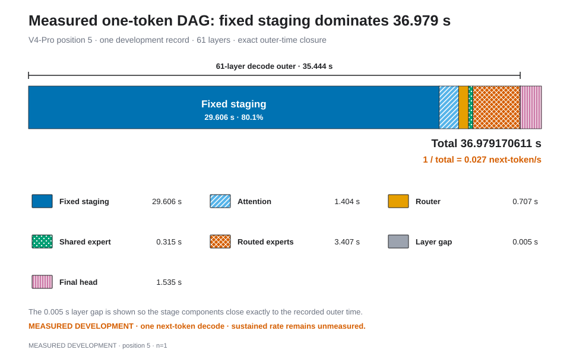
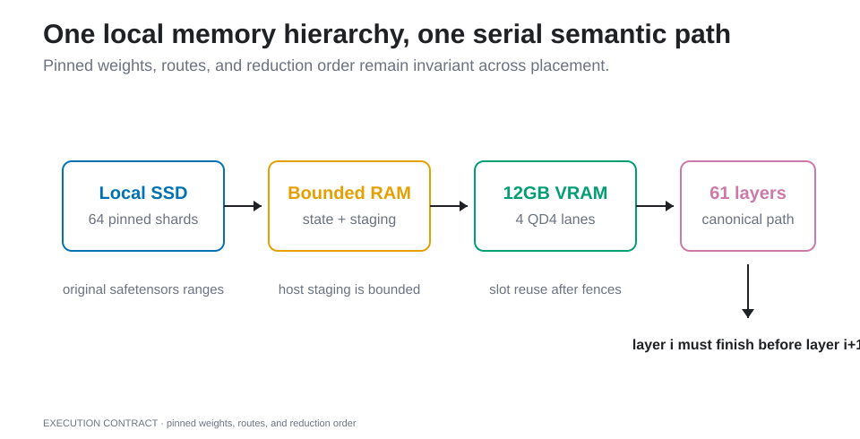
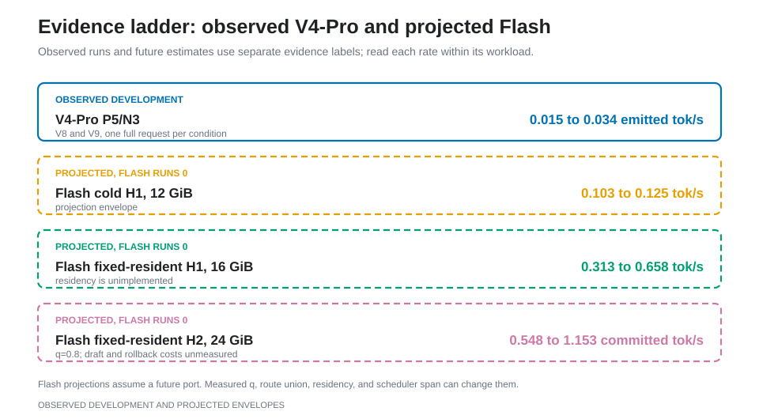

[English](README.md) | [简体中文](README.zh-CN.md)

# localMoE：想在自己的游戏本上跑一个完整的1.6T参数MoE吗？

目前的笔记本结果是一项DeepSeek-V4-Pro压力测试。固定模型共有1.6T总参数、49B激活参数，检查点大小为`805.33 GiB`。在一台配备`12,282 MiB`显存和`32 GB`内存的笔记本上，原型走完了全部61层，并在位置5用`36.979170611 s`生成了一个真实的下一个token，即`0.02704225 token/s`。证据等级为**MEASURED DEVELOPMENT**，样本量为一次解码。舒适交互与持续吞吐仍在当前证据范围之外。

未来面向家庭交互的产品目标是更小的DeepSeek-V4-Flash模型。24GiB显存档位的门槛是`0.5 to 1.0 committed token/s`，面向批处理和后台任务。证据等级为**TARGET**。Flash支持仍待实现，流畅的交互式聊天也在该目标范围之外。

localMoE是一个研究中的Rust和CUDA运行时，专门处理这类放置问题。完整检查点留在本地SSD，有界工作集在RAM和VRAM之间移动，解码、传输与计算可以重叠。路由贡献按规范顺序归约，独立的推测状态路径只提交已接受的前缀。

**MEASURED DEVELOPMENT路由范围加速：`4.117849x`**

在第4层，覆盖5个位置的QD4门槛把路由范围的中位墙钟时间从`486.604659 ms`降到`118.169615 ms`，`4/4`对结果全部精确。这是本文声称的最大加速，范围仅限一个局部路由层机制门槛。提示词E2E与token吞吐各有独立测量，生产证据仍待补充。该门槛关闭了固定权重预取。[冻结的评审工件](docs/assets/readme/data/qd4-stationary-gate/review-boundary.json)记录了范围与排除项。

[查看消费级硬件路径](#从pro验证到flash产品目标) | [复现证据](#复现证据) | [查看证据地图](#证据地图)

## 为什么做这个项目

Pro的64个固定分片全部留在本地SSD。RAM和VRAM是有界工作窗口。


| 实测系统 | 数值 |
| --- | --- |
| GPU | NVIDIA GeForce RTX 4080 Laptop，`12,282 MiB`显存 |
| 主机内存 | `32 GB`RAM |
| Pro检查点 | 64个固定分片，实际文件共`864,721,029,744 B` |
| 已执行范围 | 完整的61层Rust规范机制路径 |

这里的"完整"有严格范围：每个固定源分片都在本地，记录中的Rust路径走完了61层。官方参考数值一致性、通用生成运行时和完整服务仍是开放工作。

## Pro证明了什么

位置5的运行闭合了一份完整的解码计时账本。固定层工作占`29.606 s`，路由工作占`3.407 s`，最终输出头占`1.535 s`。记录中的各阶段加上`0.005 s`未归属间隙，精确闭合到外层总时间。



这次运行表明，原型能在经过检查的容量预算内，让一条真实的下一个token路径走完整个模型。样本量为`n=1`，因此倒数速率只作描述。热稳定状态、延迟分布和聊天速度仍待测量。

另一份确认性数据包测试了官方单用户`hi`提示词上的持久四通道QD4机制。4组配对ABBA运行中，提示词E2E中位数从`199.431954 s`降到`148.555131 s`，中位数比为`1.342477723x`。全部`4/4`对在305条层记录和最终输出上匹配。


该结果测量的是一次Rust规范机制比较的提示词E2E。下一个token吞吐、TTFT、官方参考full61一致性以及其他MoE模型都在其范围之外。

### 当前全模型路径能做什么

原型可以加载全部固定Pro分片，按官方单用户`hi`模板格式化并分词，执行完整的61层Rust规范路径，还能运行一个窄范围、只输出ID的贪心循环，并完成两步教师强制检查和EOS测试。位置5试验为5个提示词token加1个生成输入，在每一层保留一份有界状态。

有用文本生成、系统消息、工具、多轮聊天、采样、长上下文、持续吞吐和通用模型兼容性仍待支持或测量。针对固定官方参考的数值策略验收仍是开放工作。

## 减少传输字节能带来什么

近期开发轨迹隔离出了家庭运行时需要削减的两项成本。

原始固定权重传输让`wo_a`以FP8格式通过PCIe，再在GPU上解码。在每个实验臂2次配对的full61开发运行中，固定H2D从`29.062 GB`降到`24.968 GB`，节省`4.094 GB`，即`14.1%`。


严格不可变的32槽路由缓存可以避免重复源加载和H2D未命中。在每个实验臂2次配对开发运行中，路由源字节和路由H2D都从`64.223 GB`降到`29.620 GB`，每个字段节省`34.603 GB`，即`53.9%`。独立审计记录了1,830次路由、844次加载、986次命中，最大占用29，61层全部完成，回退0次，工作线程错误0次。


这些字节数属于机制证据。配对计时显示了收益保留到什么位置：GPU原始解码让E2E中位数提高`1.171788x`；路由缓存让路由墙钟中位数提高`1.430045x`；对应E2E中位数提高`1.068977x`。


图中展示了每个点和每条配对连线。每个实验臂为`n=2`，置信区间因此不可用。生产基准测试仍待完成。

## 为什么用Rust

GEMM速度仍由内核决定。Rust让磁盘到CPU解码、PCIe传输和GPU执行的重叠更容易表达，也让状态所有权保持显式。



| 运行时约束 | 具体机制 |
| --- | --- |
| 缓存槽在任务完成前保持独占租约 | 只移动的租约会把槽移出常驻映射，任务完成后再归还，从而防止提前复用和ABA式复用 |
| 运行前检查容量 | 精确字节账本覆盖QD4缓存、设备状态、RoPE、临时区和`2 GiB`余量；Rust RAII把作用域内的分配绑定到其所有者 |
| PCIe携带更小的表示 | 原始`wo_a`以FP8格式通过H2D，再在GPU上解码为BF16 |
| 并行完成后仍保持规范模型顺序 | 4个稳定工作通道组成有界池，可以按任意顺序完成；规范归约器随后按路由专家ID升序处理，最后处理共享专家 |
| 热路径存储保持稳定几何形状 | 预分配的设备状态池和严格复用的主机区在重复使用期间强制保持几何形状 |
| 只有已接受的推测行进入状态 | 前缀提交先检查权威基线，再提交已接受的行；被拒绝后缀留在语义状态之外 |

这正是Rust重写的价值。放置策略可以改变字节等待的位置，所有权与归约顺序则让已接受计算保持可审计。

## 从Pro验证到Flash产品目标

Flash是更小的未来产品候选，移植实现仍待完成。固定检查点共有`284B`总参数和`13B`激活参数，包含43层、46个分片，实际分片文件共`159,617,149,040 B`。本仓库中的Flash推理运行次数为`0`。



下表每一行都有自己的工作负载和证据等级。Pro行来自观测。Flash行根据Pro开发轨迹校准，或为未来工作规定硬性验收目标。

| 桌面显存 | 模型与路径 | 速率 | 证据边界 |
| ---: | --- | ---: | --- |
| `12 GiB` | Pro，H1位置5解码 | `0.02704 token/s` | **MEASURED DEVELOPMENT**，1个token；持续速率待测 |
| `12 GiB` | Flash，冷H1 | `0.08 to 0.12 token/s` | **CALIBRATED**，Flash运行次数`0` |
| `16 GiB` | Flash，H1 | `0.25 to 0.40 token/s` | **TARGET**，依赖待实现的固定权重/输出头常驻 |
| `24 GiB` | Flash，H2，`q≈0.8` | `0.5 to 1.0 committed token/s` | **TARGET**；当前路径校准仅为`0.20 to 0.29` |
| `32 to 48 GiB` | Flash，H5，`q≈0.8` | `0.7 to 1.5 committed token/s` | **TARGET**；依赖路由重叠，当前路径校准仅为`0.26 to 0.37` |

`H`是推测跨度，即一起验证的草稿位置数。`q`是规划假设，表示此前草稿token都已接受时，下一个草稿token被接受的条件概率。缓存命中率是独立指标，运行时对`q`的测量仍待完成。拒绝回滚、草稿成本和真实接受率分布都可能消除预测收益。

对于更小的MoE检查点，更少的固定字节、路由字节和层数会降低同类放置问题的难度。该方法仍需要每个模型的精确元数据、状态调度、路由语义和数值门槛。当前运行时只支持Pro，兼容其他模型需要独立实现与验收路径。

24GiB目标覆盖家庭工作站上的实用全模型批处理和后台推理。流畅的交互式聊天仍在目标范围之外。首批Flash工作要依次通过精确元数据与字节闭合、一个代表性路由层，以及精确的43层H1和H2运行。

## 规划中的`colibri plan`

计划中的产品入口是硬件规划器。实现仍待完成，当前构建不提供该命令。

```bash
# Planned interface. This command does not exist yet.
colibri plan \
  --model deepseek-ai/DeepSeek-V4-Flash@60d8d70770c6776ff598c94bb586a859a38244f1 \
  --vram 24GiB --ram HOST_GIB \
  --ssd-read MEASURED_SSD_GBPS --pcie-h2d MEASURED_PCIE_GBPS \
  --context CONTEXT_TOKENS --concurrency REQUESTS \
  --spec-horizon H --acceptance Q
```

输入包括精确模型版本、VRAM、RAM、实测SSD直接读取带宽、实测PCIe H2D带宽、上下文、并发数、`H`和`q`。输出应是一份放置计划，包含必需字节、容量预留与余量、预期瓶颈，以及标记为**MEASURED**、**CALIBRATED**或**TARGET**的速率等级。

该命令实现前，可以用下面的证据快速步骤检查当前结果。

## 复现证据

环境需要WSL2/Linux、CUDA 12.x、LLVM/NVPTX、libclang和Ada `sm_89`GPU。检查点应存放在WSL原生ext4文件系统上。环境约束会拒绝把`/mnt/c`和`/mnt/d`用于模型存储。按照[full61环境约束](rust/colibri-cuda/tools/V4_FULL61_ORACLE.md)设置`COLIBRI_DSV4_MODEL_DIR`、`COLIBRI_ORACLE_PYTHON`和`COLIBRI_CUBLAS_EXACT_LIB`。

```bash
git clone https://github.com/andyzpb/localMoE.git
cd localMoE/rust
cargo oxide doctor
cargo fmt --check
cargo check --locked -p colibri-cuda
./run-identified.sh test --arch sm_89
```

先验证紧凑证据封装；如果本地具备已识别的原始开发日志，再重新生成图13至图17：

```bash
cd ..
python -m json.tool docs/assets/readme/data/qd4-full61/confirmatory/summary.json >/dev/null
python -m json.tool docs/assets/readme/data/qd4-stationary-gate/review-boundary.json >/dev/null
python docs/assets/readme/generate_cost_figures.py \
  --artifact-root /mnt/colibri-native/.logs \
  --check
```

仓库携带紧凑的评审与摘要封装，大体积原始轨迹保存在仓库外。成本图命令需要本地提供这些已识别的原始开发日志。[`cost-figures-provenance.json`](docs/assets/readme/cost-figures-provenance.json)冻结了预期路径、SHA-256身份、源字段、公式、单位和证据等级。生成器会拒绝身份不匹配，并通过两次渲染检查确定性。

[机制实验记录](docs/experiments/v4-pro-mechanisms-2026-07-24.md)是精确模型运行命令和故障关闭预检的权威入口。

## 证据地图

| 证据 | 用途 |
| --- | --- |
| [位置5轨迹身份与计时公式](docs/assets/readme/cost-figures-provenance.json) | 一次真实的下一个token开发解码 |
| [原始固定权重与缓存开发证据来源](docs/assets/readme/cost-figures-provenance.json) | 配对`n=2`字节图与计时图；置信区间不可用 |
| [QD4确认摘要](docs/assets/readme/data/qd4-full61/confirmatory/summary.json) | 4组配对提示词E2E运行 |
| [QD4 L3/L4支持门槛](docs/assets/readme/data/qd4-stationary-gate/review-boundary.json) | 局部路由范围机制门槛，排除在full61确认统计之外 |

图13至图17由冻结的原始轨迹和固定的目标元数据生成。来源文件记录实测值的轨迹哈希与计算过程，并把未来硬件区间标为硬编码的**TARGET**门槛。其预测公式仍未定义。Flash硬件图为当前实测证据和未来门槛使用独立速率框架。

不同谱系的比率保持分开。`4.117849x`路由层门槛、`1.342477723x`配对提示词结果和位置5的`0.02704225 token/s`观测回答的是不同问题。

## 仓库结构

```text
rust/colibri-cuda/          Rust + cuda-oxide V4-Pro prototype
rust/colibri-cuda/tools/    oracle, trace, and evidence tools
docs/assets/readme/         deterministic figures and tracked artifacts
c/                          retained upstream C/CUDA oracle and baseline
```

## 研究状态

本仓库是研究原型。当前工作针对一个固定的DeepSeek-V4-Pro版本和一台Ada笔记本。多模型家族权重、官方参考full61验收、生成质量、长上下文、持续吞吐和服务行为仍是开放工作。

早期的层常驻、专家槽复用、阶段剖析和固定权重预取实验仍保留在技术报告与实验记录中。它们的估计量和冻结源身份不同，因此各自的比率分开报告。

## 许可证

代码继续采用[Apache License 2.0](LICENSE)。模型权重及相关材料遵循模型发布页面上的条款。保留的上游代码和素材继续遵循原有署名与许可条款。

## 灵感来源

localMoE受[JustVugg/colibri](https://github.com/JustVugg/colibri)启发。我们沿着本地运行大型MoE模型的方向继续向前，探索精确流式执行、Rust/CUDA所有权和家用硬件性能上限。
