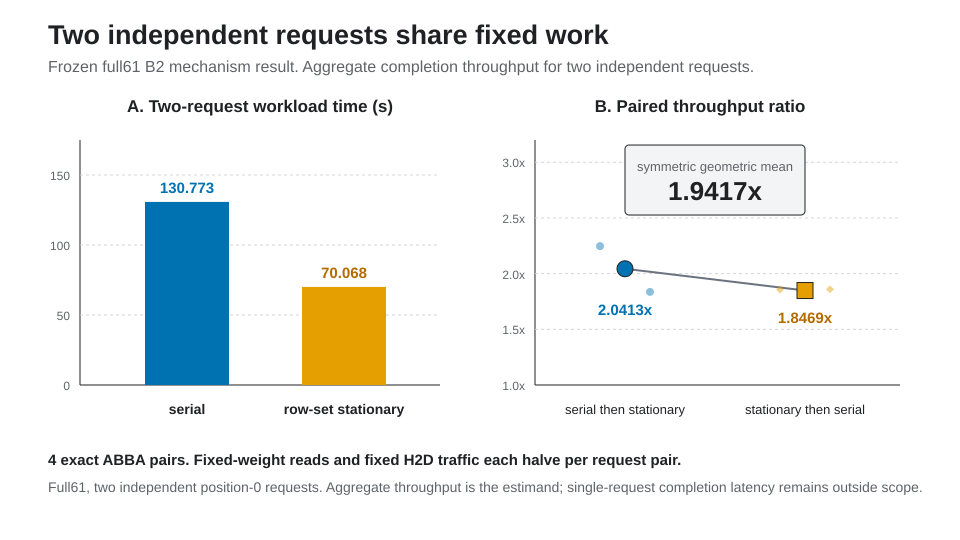

[English](README.md) | [简体中文](README.zh-CN.md)

# 想不想在你的游戏本上试试亲自全量部署1.6T的MoE大模型呢？

你的下一台LLM基础设施，何必是H100

| **1.6T参数** | **12GB显存** | **快3.58倍** |
| --- | --- | --- |
| 完整810GiB模型目录 | exact有界GPU工作集 | 198.948s降至55.550s |


localMoE是一个Rust和CUDA运行时，围绕一个很固执的想法展开：游戏本也应该能以全量权重形态运行完整DeepSeek-V4-Pro检查点。权重留在WSL原生ext4卷上，RAM和VRAM承载移动的工作集。运行时判断下一步该移动哪些字节，以及哪些工作可以共享。

在实测的12GB显存RTX4080Laptop GPU上，已验收的P5/N3请求用时`55.550s`，记录的exact基线用时`198.948s`。这个可见结果是`3.58倍`的跨来源谱系描述性加速，墙钟时间减少`72.1%`。这项历史本地比较的原始trace保存在本地证据档案中，仓库未收录。下方命令可以用当前源码复现同一workload。

## 大型MoE需要不同的运行时

V4-Pro有61个串行层。每层混合固定权重与router选择的专家。GPU无法常驻完整810GiB检查点，但每一层仍然需要在恰当的时刻拿到恰当的权重。难点在于调度数据移动，同时保持路由、归约顺序、KV状态和最终提交状态不变。

localMoE让检查点拥有一个移动的工作集：

`ext4 SSD -> CPU read and decode -> pinned RAM -> retained VRAM -> canonical GPU reduction -> transactional state commit`


当前层被消费时，下一层payload已经开始准备。固定payload可以留在host或device retention中，routed专家通过immutable cache复用。CUDA stream和有界Rust channel让磁盘读取、CPU decode、H2D复制与GPU执行同时在途。所有权保持显式：move-only lease持有cache slot直到GPU工作完成，RAII在每条退出路径释放pinned memory、event和device buffer。


## 共享模型本来就在共享的工作

独立请求各自拥有路由与状态，但它们在每一层都会经过相同的固定工作。localMoE可以让一组行一起穿过同一层，同时分开保存每条请求的状态，并让整组请求只支付一次固定工作。



对于两条独立full61请求，逐层行集合执行在密封exact比较中达到`1.9417倍`聚合完成吞吐。每个请求对的固定source流量和固定H2D流量都减半。这是双请求cohort的吞吐结果，单请求延迟仍是独立目标。

## 从游戏本走向桌面平台

运行时围绕有界内存设计，适用于不同GPU尺寸。更多显存可以常驻更多固定工作，更多主机内存可以把更多已解码payload留在GPU附近。它为12GB游戏本、16GB、24GB以及32GB到48GB显存的桌面平台给出一条清晰的升级路径。

| 家用平台 | Flash投影 | 前提 |
| --- | ---: | --- |
| 12GB游戏本 | `0.103到0.125tok/s` | cold H1 |
| 16GB桌面平台 | `0.313到0.658tok/s` | fixed-resident H1 |
| 24GB桌面平台 | `0.548到1.153 committed tok/s` | fixed-resident H2，`q=0.8` |
| 32GB桌面平台 | `0.500到1.052 committed tok/s` | fixed-resident H5，`q=0.8` |
| 48GB工作站 | `0.500到1.052 committed tok/s` | 沿用冻结的32GB到48GB H5包络 |

各行应在自身scheduler假设内比较：H2与H5采用不同的scheduler span和连续提交窗口，因此横向排名需要先对齐这些假设；更大显存带来更长的可用窗口和更多余量。


这些Flash范围属于设计投影，目前Flash基准运行数为0。随着更多固定工作进入常驻区，同一调度模型有机会释放表中的性能。32GB与48GB配置共享冻结的H5包络。fixed residency、draft成本、rollback、实际专家并集、scheduler span和接受率仍需测量。

## 此处exact的含义

localMoE保持Rust引擎声明的规范约束：在已测试谱系内，路由顺序、归约、KV更新、lease释放和transactional state commit都经过检查。头条完整请求对比的两个端点来自不同来源谱系，因此属于描述性结果。官方PyTorch完整模型一致性、长上下文行为、提示词质量、sampling和持续吞吐仍有各自的验收目标。

实验协议、原始证据边界和限制都在[技术机制记录](docs/experiments/v4-pro-mechanisms-2026-07-24.md)中。README保持产品故事简洁，那份记录负责让每个主张可以检查。

## 运行完整检查点

当前路径面向WSL2/Linux、CUDA12.4、LLVM/NVPTX、libclang和Ada`sm_89`。固定模型revision必须存放在WSL原生ext4块设备，运行时会拒绝`/mnt/c`和`/mnt/d`。

```bash
git clone https://github.com/andyzpb/localMoE.git
cd localMoE/rust

export COLIBRI_DSV4_MODEL_DIR=/mnt/colibri-native/deepseek-v4-pro-b5968e9190ef611bbf34a7229255be88a0e937c1
export COLIBRI_CUBLAS_EXACT_LIB=/usr/local/cuda-12.4/targets/x86_64-linux/lib/libcublas.so.12.4.5.8
export LD_LIBRARY_PATH=/usr/local/cuda-12.4/targets/x86_64-linux/lib:${LD_LIBRARY_PATH:-}

cargo oxide doctor
./run-identified.sh build --arch sm_89 -- --release -p colibri-cuda
export COLIBRI_SOURCE_IDENTITY_MANIFEST="$PWD/.source-identity.manifest"
export COLIBRI_SOURCE_IDENTITY="$(sha256sum "$COLIBRI_SOURCE_IDENTITY_MANIFEST" | cut -d' ' -f1)"
export LOCALMOE_RUN_DIR="$(mktemp -d)"
```

使用文本prompt运行实测P5/N3单请求路径：

```bash
/usr/bin/time -f 'single_request_wall=%e s' env \
  COLIBRI_V4_FULL61_B1=1 \
  COLIBRI_V4_LAYER_STATIONARY_PREFILL=1 \
  COLIBRI_V4_GENERIC_DEVICE_STATIONARY=1 \
  COLIBRI_V4_CHAT_USER=hi \
  COLIBRI_V4_GREEDY_STEPS=3 \
  COLIBRI_V4_MAX_LAYERS=61 \
  COLIBRI_V4_DEVICE_FIXED_CACHE_GIB=0 \
  COLIBRI_V4_HOST_FIXED_CACHE_GIB=0 \
  COLIBRI_V4_STATIONARY_RAW_DEVICE_RETENTION_GIB=4.0 \
  COLIBRI_V4_STATIONARY_RAW_HOST_RETENTION_GIB=13 \
  COLIBRI_V4_LAYER_STATIONARY_FIXED_PREFETCH=1 \
  COLIBRI_V4_RAW_WO_A_GPU_DECODE=1 \
  COLIBRI_V4_PINNED_FIXED_PIPELINE=1 \
  COLIBRI_V4_BOUNDED_READAHEAD=1 \
  COLIBRI_V4_ROUTED_QD4=1 \
  COLIBRI_V4_QD4_IMMUTABLE_EXPERT_CACHE=1 \
  COLIBRI_V4_SPARSE_ATTN_ARM=sm89_crossover \
  COLIBRI_V4_RESULT_JSONL="$LOCALMOE_RUN_DIR/single.jsonl" \
  "$PWD/target/release/colibri-cuda"
```

让两条full61 greedy请求通过同一个B2行集合：

```bash
/usr/bin/time -f 'b2_cohort_wall=%e s' env \
  COLIBRI_V4_B2_GENERATE=1 \
  COLIBRI_V4_B2_TOKEN_IDS='0;1' \
  COLIBRI_V4_GREEDY_STEPS=1 \
  COLIBRI_V4_RESULT_JSONL="$LOCALMOE_RUN_DIR/b2.jsonl" \
  "$PWD/target/release/colibri-cuda"
```

两条路径都会对严格规范检查执行fail closed，并在61层全部完成后提交结果。头条采用JSONL中的`request_e2e_ns`模型请求时间，`/usr/bin/time`还包含进程启动与退出。结果JSONL保存输出ID和final digest，用于exact检查。

代码采用[Apache License 2.0](LICENSE)。模型权重遵循各自的发布条款。

## 灵感

localMoE受[JustVugg/colibri](https://github.com/JustVugg/colibri)启发，并沿着这条路线继续推进家用硬件上的exact全量MoE推理。
