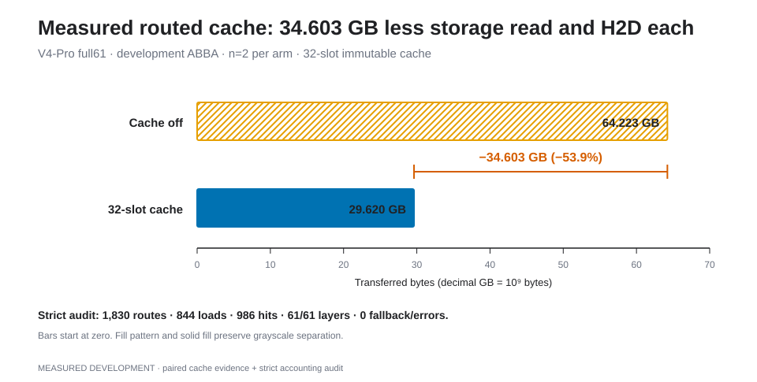
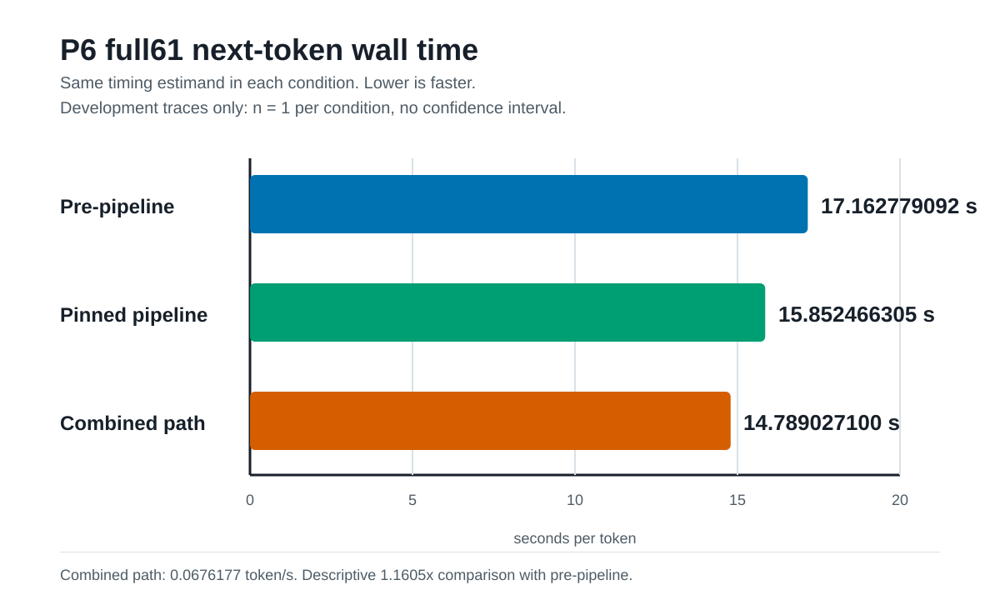

[English](README.md) | [简体中文](README.zh-CN.md)

# localMoE：想不想在你的游戏本上亲自部署全量1.6T参数MoE？

localMoE在配备RTX4080Laptop GPU、12GB显存和32GB RAM的笔记本上，从本地SSD调度完整`864.7GB`、61层的DeepSeek-V4-Pro检查点。该模型是1.6T参数MoE，包含64个官方混合FP4-FP8权重分片。Rust把移动工作集限制在有界窗口中，完整检查点留在本地。

## 完整请求快2.23倍，模型与exact状态检查保持一致

主结果比较两次完整P5/N3请求。它们使用同一固定模型版本、prompt IDs、贪心输出、61层调度和状态审计约束。V8记录QD4关闭，V9记录QD4开启。两次run-identified source identity不同，因此该比率属于描述性开发比较。


| 完整请求条件 | 请求墙钟时间 | 输出速率 | 状态结果 |
| --- | ---: | ---: | --- |
| V8，QD4关闭 | `198.947779573 s` | `0.015079334 tok/s` | PASS |
| V9，QD4开启 | `89.277349596 s` | `0.033603148 tok/s` | PASS |

描述性比率为`2.228423900x`，请求延迟降低`55.125234%`。两次运行都输出`[115287,115287,115287]`，走完61层，完成427次事务式提交，并在P4、P5和P6通过183次层状态审计。JSONL的SHA-256身份分别为`781ccffe…`和`52d7c04b…`。每个条件`n=1`，当前证据记录两次开发运行。[Benchmark ledger](docs/assets/readme/cost-figures-provenance.json)记录完整artifact hash、完整run-identified source identity、输入、公式与适用范围。

这里的exact指记录下来的Rust规范路由、归约和状态边界。官方PyTorch full61一致性有独立验收门槛。

## 最大模型的压力测试

检查点大于两级快速内存。运行时需要流式搬运权重，同时保持规范归约顺序，避免提交部分持久状态。


| 记录硬件 | 数值 |
| --- | --- |
| GPU | NVIDIA GeForce RTX4080Laptop，`12,282MiB`显存 |
| 主机内存 | `32GB` RAM |
| 检查点 | 64个固定分片，实际文件共`864,721,029,744B` |
| 已执行路径 | 完整61层Rust规范机制路径 |

这里的完整指每个固定分片都在本地，记录的路径走完全部61层。通用聊天、采样、长上下文、热稳定持续吞吐、服务行为和官方参考一致性仍需要独立评估。

## 机制证据

完整请求比较持续检查规范路由和状态提交，同时记录每次运行的QD4配置。

局部L4/P5门槛把路由墙钟时间从`486.604659ms`降到`118.169615ms`，加速`4.117849x`，全部`4/4`配对exact。它的估计量是路由层墙钟时间；完整请求吞吐使用上方独立的完整请求运行。

独立的full61 ABBA数据包把prompt E2E从`199.431954s`降到`148.555131s`，中位数比为`1.342477723x`。`4/4`配对都exact，每对包含305条层记录和最终输出。


其他保留实验说明了流式路径为什么还有可移动的空间：

| 机制与估计量 | 观察结果 | 证据边界 |
| --- | --- | --- |
| 原始GPU固定解码，full61 H2D | `29.062GB`降到`24.968GB`，减少`14.1%` | 每臂`n=2`配对开发证据 |
| 不可变32槽路由缓存，每字段字节数 | `64.223GB`降到`29.620GB`，减少`53.9%` | 配对开发证据与严格账本审计 |
| 原始GPU固定解码，请求E2E中位数 | `1.171788x` | 每臂`n=2`配对开发证据 |
| 路由缓存，路由墙钟中位数 | `1.430045x` | 每臂`n=2`配对开发证据 |
| 路由缓存，请求E2E中位数 | `1.068977x` | 每臂`n=2`配对开发证据 |





每个比率回答不同估计量。局部`4.117849x`门槛、`1.342477723x`提示词数据包和`2.228423900x`P5/N3完整请求比较各自保持独立。

## Rust路径为什么重要


当前运行时使用move-only lease管理缓存所有权，用带类型的FP4-FP8 geometry做容量检查，用有界worker和pinned staging处理搬运，用规范路由归约和事务式状态提交保持语义边界。Colibri自有CUDA kernel由`cuda-oxide`实现。这些约束使存储、CPU decode、H2D和GPU执行可以重叠，同时留下可审计的状态边界。

## 第二条开发谱系

最早的P6下一个token轨迹从`36.979170611s/token`降到`14.789027100s/token`，描述性变化为`2.500446470x`，延迟降低`60.007142%`。倒数速率从`0.0270422506tok/s`升到`0.0676177002tok/s`。




图中记录的是更窄的P6 pre-pipeline比较，结果为`1.1605x`。旧的`36.979170611s/token`工件已在账本和保留图中标识。当前`14.789027100s/token`记录复制到tracked artifact packet的工作仍待完成，因此这条谱系属于次级开发证据。它使用同一固定模型家族和exact运行时边界，请求形状与P5/N3主比较不同。

## Flash预测范围

本仓库中的DeepSeek-V4-Flash运行次数为`0`。下列速率是未来Flash移植的重新计算预测范围。Flash实现和实测运行会构成基准证据。


| 硬件与方案 | 预测提交速率 | 假设 |
| --- | ---: | --- |
| 冷H1，12GiB | `0.103至0.125tok/s` | Flash运行次数`0` |
| 固定权重常驻H1，16GiB | `0.313至0.658tok/s` | 固定权重常驻尚未实现 |
| 固定权重常驻H2，24GiB，`q=0.8` | `0.548至1.153tok/s` | 草稿和回滚成本未测 |
| 固定权重常驻H5，32至48GiB，`q=0.8` | `0.500至1.052tok/s` | 路由并集和调度跨度未测 |

H2和H5范围对条件接受率假设`q`敏感：

| `q` | H2提交速率 | H5提交速率 |
| ---: | ---: | ---: |
| `0.7` | `0.492至1.035tok/s` | `0.399至0.839tok/s` |
| `0.8` | `0.548至1.153tok/s` | `0.500至1.052tok/s` |
| `0.9` | `0.609至1.281tok/s` | `0.635至1.336tok/s` |

Flash固定权重常驻、草稿成本、回滚、实际路由并集、调度跨度和`q`都等待测量。更小的开源MoE应使用参数化roofline评估，输入包括active fixed-miss bytes、routed-expert union、PCIe/GPU服务时间和输出头成本。这些活跃的数据移动和计算项决定速度。

## 复现当前路径

环境需要WSL2/Linux、CUDA12.x、LLVM/NVPTX、libclang和Ada `sm_89`GPU。检查点必须存放在WSL原生ext4文件系统。环境约束会拒绝把`/mnt/c`和`/mnt/d`用于模型存储。按照[full61环境约束](rust/colibri-cuda/tools/V4_FULL61_ORACLE.md)设置`COLIBRI_DSV4_MODEL_DIR`、`COLIBRI_ORACLE_PYTHON`和`COLIBRI_CUBLAS_EXACT_LIB`。

```bash
git clone https://github.com/andyzpb/localMoE.git
cd localMoE/rust
cargo oxide doctor
cargo fmt --check
cargo check --locked -p colibri-cuda
./run-identified.sh test --arch sm_89
```

[机制实验记录](docs/experiments/v4-pro-mechanisms-2026-07-24.md)包含模型运行命令和故障关闭预检。[Benchmark ledger](docs/assets/readme/cost-figures-provenance.json)记录紧凑公开身份和图表输入。

## 仓库结构

```text
rust/colibri-cuda/          Rust + cuda-oxide V4-Pro prototype
rust/colibri-cuda/tools/    oracle、trace和evidence工具
docs/assets/readme/         确定性图表和紧凑证据工件
c/                          保留的上游C/CUDA oracle和baseline
```

## 许可证

代码继续采用[Apache License 2.0](LICENSE)。模型权重及相关材料遵循模型发布页面上的条款。保留的上游代码和素材继续遵循原有署名与许可条款。

## 灵感来源

localMoE受[JustVugg/colibri](https://github.com/JustVugg/colibri)启发，并希望把本地MoE执行继续往前推进。
