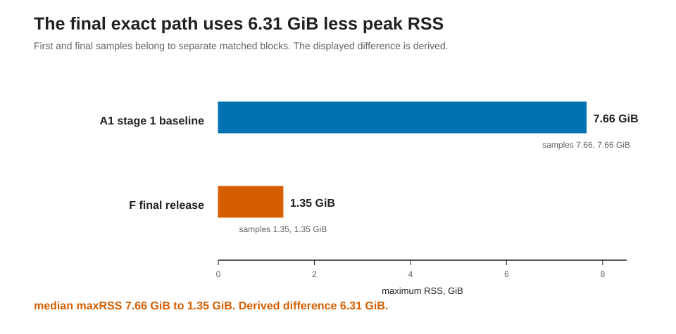

[English](README.md) | [简体中文](README.zh-CN.md)

# 想不想在你的游戏本上试试亲自全量部署1.6T的MoE大模型呢？

你的下一台LLM基础设施，何必是H100

| 全量检查点 | exact优化链 | 最终游戏本结果 |
| --- | --- | --- |
| 1.6TFlash-0731FP4权重 | 两个匹配区块派生7.11倍 | 12GB显存RTX4080Laptop GPU上0.0762tok/s |


localMoE让游戏本运行全量权重的DeepSeek-V4-Flash-0731检查点，把内存移动视为推理工作。模型保存在WSL原生ext4卷。每一层把固定tensor与6个routed专家带入有界工作集，CUDA完成对应工作后才释放lease。

完整优化链从单token、43层请求的`93.349479730s`开始，最终达到`13.126173804s`。这是跨两个独立匹配新进程区块派生的`7.111705294倍`端到端优化链，最终中位数约为`0.0762tok/s`。该比值连接两个区块的中位数，README将它标记为派生链路值。

| 匹配区块 | 变化 | exact计时结果 |
| --- | --- | --- |
| `A-B-B-A` | 一个已经检查的cuBLAS session和workspace覆盖请求内mHC与router调用 | `93.349479730s`降至`34.611048076s`，配对中位数`2.697283513倍`，`4/4` exact |
| `A-F-F-A` | 同一个请求级session继续覆盖compressor与indexer | `31.973254411s`降至`13.126173804s`，配对中位数`2.435841263倍`，`4/4` exact |

精简的[样本台账](docs/assets/readme/flash-0731-abba.csv)记录全部8个E2E数值、maxRSS、binary SHA-256和exact gate。final-release二进制SHA-256为`6a47f8fe48c87f4205f8f835a60f2f824940dea67c198463ccfb60ccf333bb77`。它的独立full43证书运行用时`14.298313983s`，maxRSS为`1,412,424KiB`，该证书运行位于匹配计时区块之外。



第一组A区块的maxRSS中位数约为`7.66GiB`，最终F区块约为`1.35GiB`。这些样本来自不同匹配区块，因此图中的`6.31GiB`减少量与完整加速链一样属于派生结果。

## 一个请求，一条经过检查的CUDA生命周期

Rust让请求生命周期变成明确对象。请求拥有CUDA stream、event、pinned staging buffer、cache slot、已经检查的cuBLAS handle及其workspace。排队的GPU操作会持续持有lease。少量有状态CUDA对象因此能够跨43层保持热态，流式权重仍然保持有界。

第一个匹配区块让已经验证的cuBLAS handle与workspace跨越mHC和router linear调用。最终审查修复使同一生命周期继续经过compressor与indexer。最终profile中的attention时间从`19.862862s`降至`1.586645s`。这是一条所有权规则在整条固定权重路径上的一致表达。

server遵循同样的规则。它的`gpu_exact` final head在`READY`时从活跃模型初始化，属于runtime的一部分。捕获artifact目录位于服务启动路径之外。strict compressor与DSpark路径也会复用经过检查的session。

## exact Flash-0731执行

exact路径固定了控制路由和状态的数值工作：FP8MMA累积、有序归约、RMSNorm行为、cuBLAS compressor调用、KV更新以及GPU final head。对token ID`0`的一步greedy路径，`43/43`层在声明的比较字段上匹配捕获的官方reference。最终argmax为`33832`，已检查digest如下：

```
collapsed BF16   5e9764a6e105a3d6
normalized BF16  91495daa576afcb3
logits FP32      e9d90c64a1441d20
```

该证书覆盖固定Flash-0731revision、一个prompt token、一步greedy路径与捕获reference字段。长上下文行为、sampling质量、持续多用户吞吐和其他prompt都需要各自的证据。

## DSpark提交经过验证的前缀

DSpark先提出一个block，再计算base target，随后提交被接受的前缀。状态transaction在提交前携带base和3个MTP状态digest。已记录的B regression运行在`161.55s`内通过，maxRSS为`1.124GiB`。它完成8个base等价计数，覆盖2个prompt与6个validated input，生成`[33832]`，接受`0`个proposal，提交1个input，保留pending token`120159`，并记录4个状态digest。

DSpark结果台账与certified-base台账具有逐字节相同的SHA-256`34734f…e553`。保留的artifact集合包含transaction记录与4个状态digest。`exact-vs-certified-base`定义这份证据的边界。独立官方DSpark oracle属于后续验证工作。

## 从游戏本走向桌面平台

当前12GB路径的最终F组中位值为`0.0762tok/s`。下表保留早期内存常驻模型的相对容量乘数，并把它们应用于这个实测中位数。它们是配置容量估算，目前缺少benchmark运行证据。不同scheduler窗口仅适合指导配置。

| 硬件 | 容量估算 | 模型假设 |
| --- | ---: | --- |
| 12GB游戏本 | `0.0750到0.0774tok/s` | 已观测的最终F组样本 |
| 16GB桌面平台 | `0.209到0.440tok/s` | fixed-resident H1乘数 |
| 24GB桌面平台 | `0.366到0.771committed tok/s` | fixed-resident H2，`q=0.8`模型 |
| 32GB到48GB工作站 | `0.334到0.703committed tok/s` | fixed-resident H5，`q=0.8`模型 |

估算使用`0.0761837tok/s`，乘以早期容量模型区间再除以其12GB中点`0.114tok/s`。fixed residency、route union、draft成本、rollback、scheduler span与接受率仍需要在每台机器上测量。

## 运行

Flash路径面向WSL2/Linux、CUDA13.1、Blackwell`sm_120`，模型目录必须位于WSL原生ext4块设备。运行时会拒绝`/mnt/c`和`/mnt/d`下的模型路径。

```bash
git clone https://github.com/andyzpb/localMoE.git
cd localMoE/rust

export COLIBRI_DSV4_MODEL_DIR=/mnt/colibri-native/deepseek-v4-flash-0731-9e165c30e2704aec5d9d593cce3eebd58bbef1cb
export COLIBRI_CUBLAS_EXACT_LIB=/usr/local/cuda/targets/x86_64-linux/lib/libcublas.so.13.2.1.1
export LD_LIBRARY_PATH=/usr/local/cuda/targets/x86_64-linux/lib:${LD_LIBRARY_PATH:-}

cargo oxide doctor
./run-identified.sh build --arch sm_120 -- --release -p colibri-cuda
```

在`sm_120`上运行真实的单token Flash base路径：

```bash
env \
  COLIBRI_V4_FLASH_BASE=1 \
  COLIBRI_V4_FLASH_TOKEN_IDS=0 \
  COLIBRI_V4_GREEDY_STEPS=1 \
  COLIBRI_V4_STREAM_READ_MODE=buffered \
  COLIBRI_V4_FLASH_PREFETCH=1 \
  COLIBRI_V4_FLASH_MHC_LINEAR_ARM=cublas \
  COLIBRI_V4_FLASH_ROUTER_LINEAR_ARM=cublas \
  COLIBRI_V4_FLASH_ROUTER_SCORE_ARM=libdevice \
  COLIBRI_V4_FLASH_FP4_ACCUM_ARM=fp8_mma \
  COLIBRI_V4_FLASH_FINAL_HEAD_ARM=gpu_exact \
  COLIBRI_V4_RESULT_JSONL="$PWD/flash-result.jsonl" \
  "$PWD/target/release/colibri-cuda"
```

检查`flash-result.jsonl`里的`layers: 43`和final`status: PASS`。当前0731 ModelScope运行已在`sm_120`上完成runtime验证；上面的`33832`和digest仍是独立oracle gate，必须重新生成匹配的full-43 oracle后才能宣称通过。模型使用遵循检查点许可证，localMoE代码采用[Apache License 2.0](LICENSE)。

## 灵感

localMoE受[JustVugg/colibri](https://github.com/JustVugg/colibri)启发，并继续推进家用硬件上的可用全量权重MoE推理。
